<div align="center">


# 苏哥的钓鱼竿

### 网页上的视频、图片、音频，抓下来就是能用的素材

不是又一个下载器。**抓到的同时就起好名、归好档、入好库**——省掉下载之后那一小时的搬文件。

[](LICENSE)
[](#)
[](#安装)
[](#工程底子)
[](#工程底子)

[安装](#安装) · [三分钟上手](#三分钟上手) · [功能全景](#功能全景) · [同类对比](#和同类产品比) · [限制](#都写在明面上的限制)

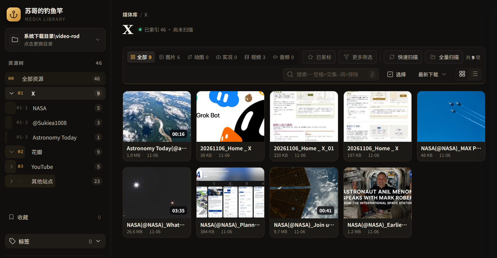

</div>

---

## 下载完，不用再整理

用过 Eagle 或 Billfish 的人都懂那个流程：先下二十个散文件到 `Downloads`，再挨个改名，再拖进素材库，再打标签。**真正花时间的不是下载，是下载之后。**

工具为什么不管这一段？因为市面上的产品各管一截：

- 下载器（IDM、猫抓）只管把字节拉下来，不懂什么叫素材
- 素材库（Eagle、Billfish）不会抓网页，只能等你拖进去
- 抓图插件（Fatkun 类）只看图片，视频一概不管

钓鱼竿做的是把这段缝上：**抓到的那一刻就决定它叫什么、放哪里、怎么被找回来。** 下载动作结束的时候，素材已经在库里了。

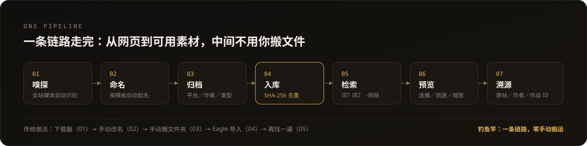

---

## 三条别人不容易补齐的能力

### 01 下载即归档：文件落地的位置就是它的分类

传统做法是「先下一堆，再手动搬」。这里改成了：**落地路径 = 平台 / 作者(@ID) / 类型 / 文件名**。

路径不是写死的清单，是四级回退：你手改过的名字 → 381 条预置站名 → 下载时从页面读 `og:site_name` / PWA manifest / `<title>` → 都没有才用域名。**所以任何网站都能下，收录与否只影响显示名，不影响可用。**

```
Downloads/video-rod/
├── YouTube/Exploropia/视频/Guangzhou, China by Drone 4K_1920p.mp4
├── x/NASA(@NASA)/images/NASA(@NASA)_MAX POWER, America's newest…_06.jpg
├── 小红书/BoBo/BoBo_公众号排版【第6期】.mp4
├── B站/人民空军(@360421127)/视频/人民空军(@360421127)_过瘾！升格画面中的歼-20.mp4
└── example.com/example.com/                        ← 没收录的站点用域名，照样能下
```

文件名叫什么也由你定。默认 `${author}_${title}`，模板里 `/` 就是目录分隔符——`${site}/${author}/${title}` 一行改完，全站归档规则跟着变；同名自动 `_01`、`_02`，不覆盖。

可用变量：`${title}` `${post}` `${author}` `${site}` `${index}` `${date}` `${ext}`；起名时会自动剥掉「标题_网站名」尾巴、去掉推文的「某人 在 X:」前缀与 `t.co` 链接、清洗 `\ / : * ? " < > |`、60 字截断。

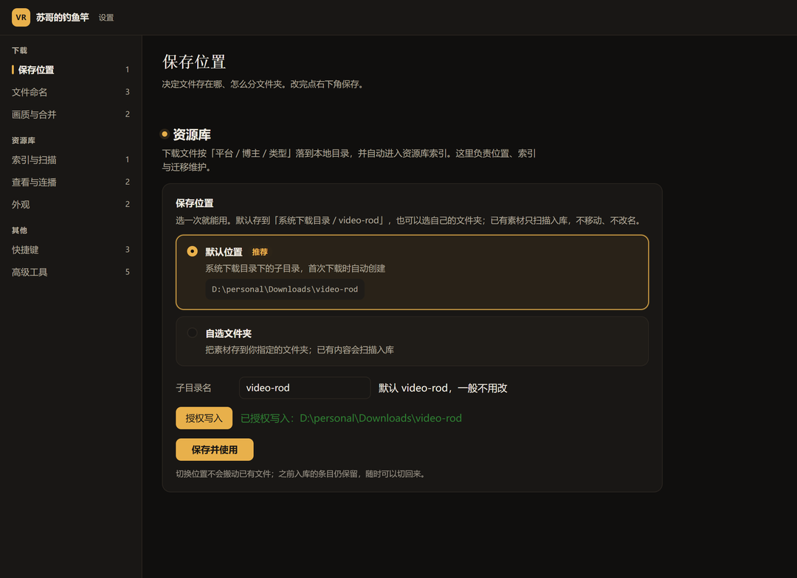

### 02 内容级去重 + 永久溯源：存得住，也找得回

**去重不是「文件名相同就跳过」这种粗活**，而是 SHA-256 内容寻址 + 引用计数（网盘秒传的原理）：

| 场景 | 结果 |
|---|---|
| 同一张图从不同 URL、不同平台下两次 | 物理只存一份，第二条只记引用 |
| 删掉其中一条 | 引用计数 −1，最后一条消失才真删文件 |
| 统计口径 | 逻辑大小 / 物理占用，两个数分开报 |

每条素材同时记下 **原帖地址 / 作者 ID / 作品 ID / 直链**。直链带签名会过期，但原帖地址永久有效——这才叫「存下来了」。重建索引、换电脑迁移都不丢。

溯源徽标不假装：**已记录 / 部分记录 / 未记录 / 推断** 四态，缺哪一半就照实显示。

### 03 视频不借云端转码：画质不打折，也不上传

- **HLS 离线直连**：多线程拉流 + AES-128 解密 + 本地合成 MP4，**视频不出本机**
- **B站 / YouTube 双轨合并**：视频轨 + 音频轨本地无损合并，不重编码
- **断流续传**：googlevideo 长连接被掐断时按 Range 从断点续，不用整条重下
- **多段 m3u8 手动拼接**：分散的大段按顺序拼成一个文件
- **B站 1080P**（需合成）、**YouTube 1080p**、**抖音详情接口取最高档**，都是实机验过的

---

## 界面：一屏看清，不用翻菜单

### 面板：这一页抓到了什么，一眼看完

<p align="center">
  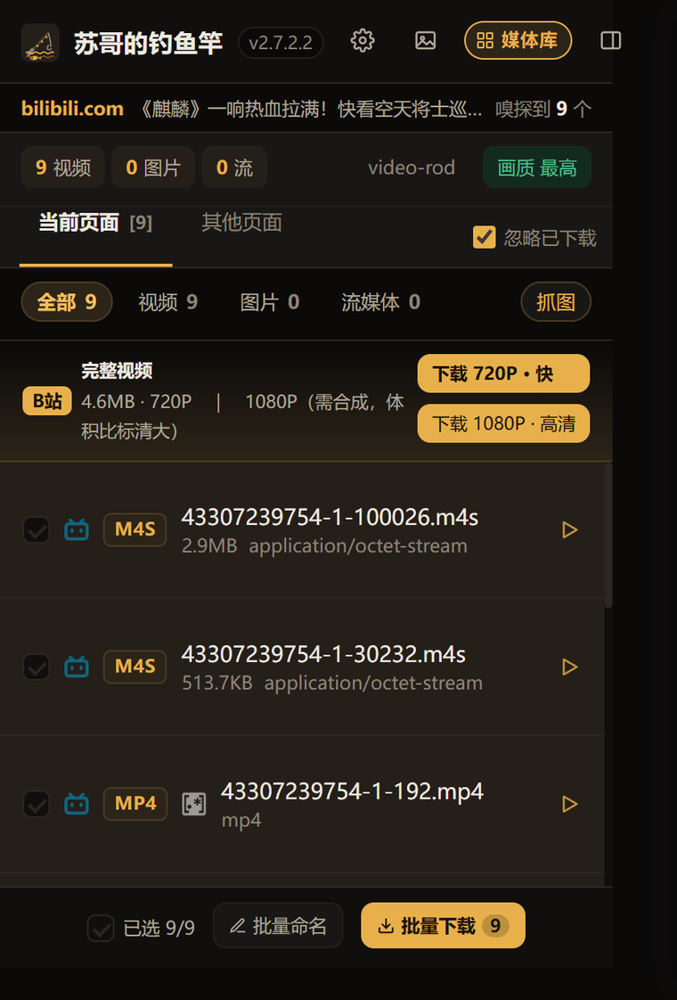
</p>

打开就列出本页全部媒体：视频、图片、音频、流媒体分开计数，画质一键切换。

- 文件名不满意 → 展开该行直接改
- 存哪不满意 → 点目录 chip 换
- 不想要 → 取消勾选
- 全都要 → 批量下载，或先批量命名

B站这类「视频轨 + 音频轨分离」的站点，面板会多给一行**完整视频**：想看 720P 就点「快」，要 1080P 就点「需合成」，合并全在本地完成。

X（推特）的推文里，操作栏会多一个下载按钮——**看到就点，不用开面板**。

### 鼠标停在视频上，就能下

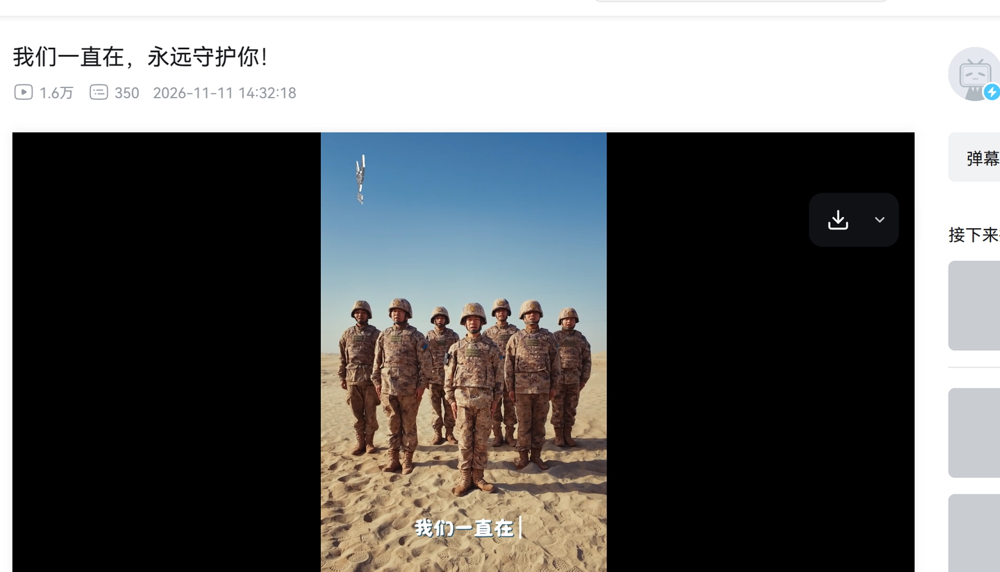

鼠标移进播放区域，右上角出现下载按钮：**点图标下当前最高清，点旁边箭头挑一档**。按钮用矩形命中，播放器自己的标题条、封面条挡不住它；全屏时自动隐藏，不碍事。

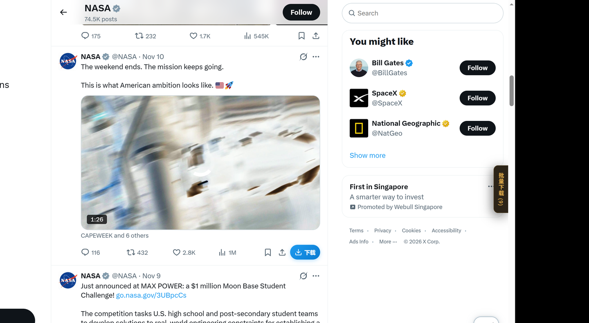

主页批量同理：打开博主主页，右下角浮标显示「批量下载 (N)」，**你手动往下滚，它只记录已经渲染出来的内容**（不自动翻页，不惹风控），滚够了点开勾选即可。微博、X、小红书都支持。

### 图片：能单张，也能整页、整个图集

网页图片这条路做的是「四件套」：

| 入口 | 怎么用 |
|---|---|
| **悬停单张** | 鼠标停在图上浮出保存按钮，`Alt+Shift+D` 直接存鼠标下这张 |
| **悬停批量** | 悬停时出现「本页共 N 张」确认条，一次收走 |
| **图片清单面板** | `Alt+Shift+A` 打开网格清单：缩略图 + 真实尺寸 + 勾选 + 排序 |
| **图集翻页** | 「加载更多」自动滚到底收懒加载，再跟着「下一页」最多翻 10 页，随时可停 |

尺寸过滤不是手填像素，而是**五个档位，每档实时显示命中几张**——小的滤掉图标，超大档直取 4K / 印刷级：

| 档位 | 判定（短边） | 典型用途 |
|---|---|---|
| 小 | ≥ 100px | 默认线，滤图标 / 装饰图 |
| 中 | ≥ 500px | 普通可用配图 |
| 大 | ≥ 1200px | 壁纸 / 高清素材 |
| 超大 | ≥ 2000px | 4K / 印刷级 |
| 自定义 | 手填宽×高 | 特殊需求 |

扫描源不止 ``：`srcset` 最高分辨率、`<picture>/<source>`、CSS 背景图、懒加载属性（`data-src` 等）、shadow DOM、视频封面图都算，并用 MutationObserver 跟住滚动加载。

### 素材库：五万条也不卡

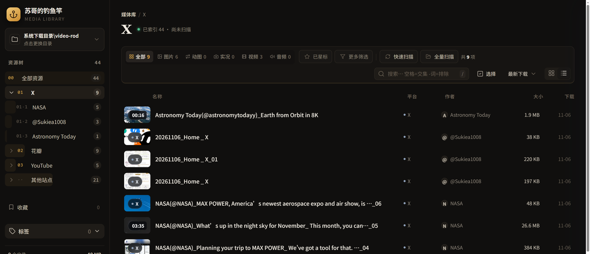

左栏是按平台／作者的资源树，带计数；右侧网格与列表双视图一键切换。**超过 300 条只渲染可视区**——实测 5 万条首屏 105ms、DOM 只有 49 个节点，翻起来和几十条没区别。

要批量处理，切「选择」：全选／反选／按类型选，然后加入收藏夹、移动、或移入回收站。

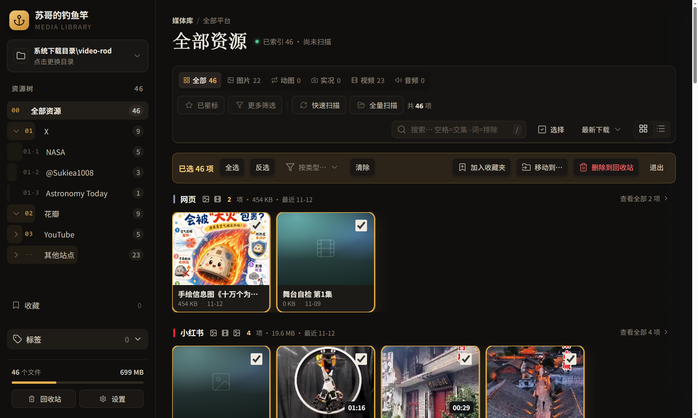

搜索框是 booru 语法：`词1 词2` 取交集，`-词` 排除。

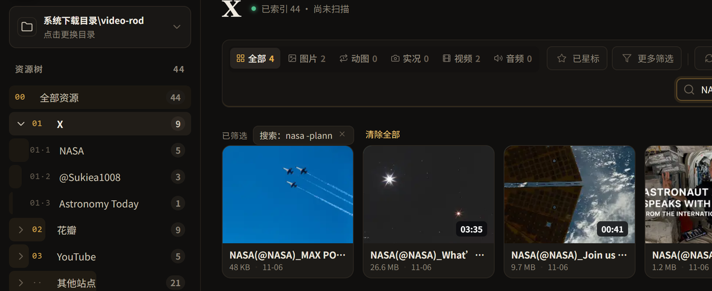

要按大小、分辨率、作者多选着筛，用「更多筛选」——低频条件收在这里，选完即时生效，不占主界面。

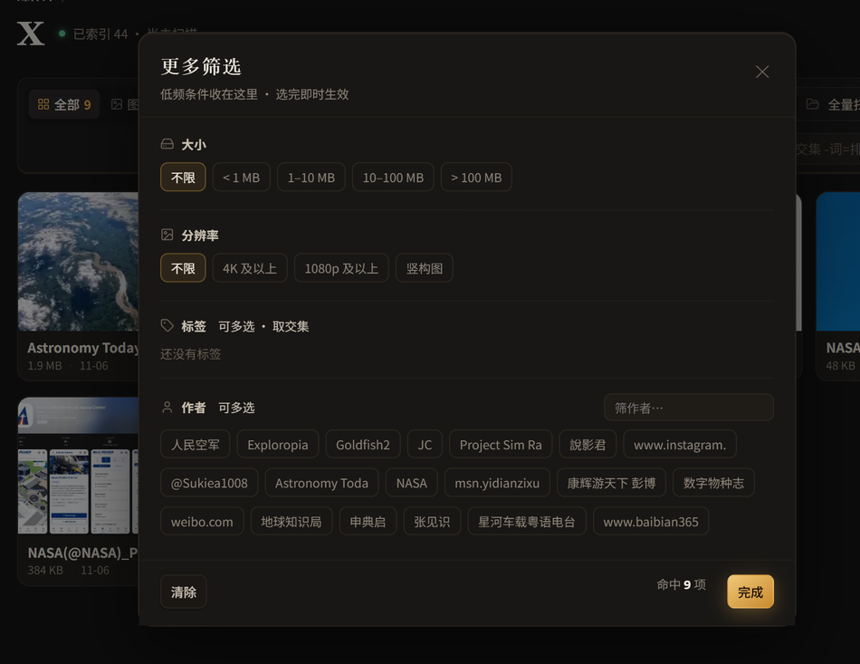

**删除是软删除**。移进回收站只记路径与元数据、不占额外空间，恢复时回到原来的相对路径：

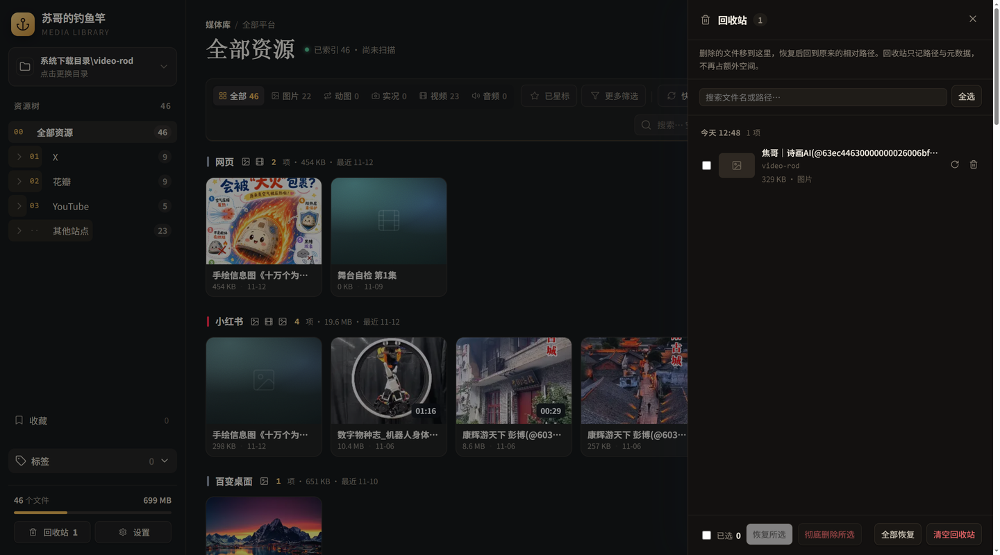

### 预览器：连着看，不用反复开关

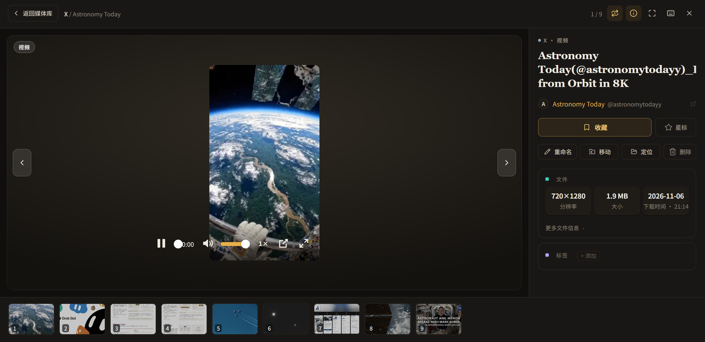

单击卡片直接进预览：**视频播完自动下一条**（可关）、10 档倍速 0.1×–3×、图片缩放旋转适应、GIF/APNG 逐帧与循环控制、底部胶片条跳转。右侧信息栏只留能用的字段——分辨率、大小、下载时间、路径，其余从面包屑和角标就能推出来的，一律不重复列。

键盘是完整的一套，不用摸鼠标：

| 场景 | 键 |
|---|---|
| 上一条 / 下一条 | `←` `→` `↑` `↓` |
| 播放 / 暂停 | `Space` `K` |
| 快进快退 5 秒 · 逐帧 | `←` `→` · `,` `.` |
| 音量 / 静音 · 倍速 | `↑` `↓` `M` · `>` `<` |
| 跳到 10%–90% | `0`–`9` |
| 图片缩放 / 适应 / 1:1 / 旋转 | `+` `-` · `0` · `1` · `R` |
| 信息栏 · 全屏 | `I` · `F` |

右键卡片还能：重命名 / 移动 / 定位 / 收藏 / 星标 / Google 识图 / 移入回收站。

---

## 功能全景

一张表看完它到底能干什么。✅ 已上线并验过，◐ 有限支持。

### 下载端

| 能力 | 说明 |
|---|---|
| ✅ 全站媒体嗅探 | 视频 / 音频 / 图片 / 流媒体分开计数，任意站点，不靠站点清单 |
| ✅ 清晰度自动最高 | 多档时默认勾最高，设置里可关（清晰度解析有独立单测） |
| ✅ 智能起名 | 标题 / 推文正文 / 昵称(@账号)，清洗非法字符、60 字截断、同名加序号 |
| ✅ 命名模板 | 7 个变量 + `/` 当目录分隔符，改一行全站生效，实时预览 |
| ✅ 下载到文件夹 | 平台 / 作者(@ID) / 类型，多 P 再单独一层 |
| ✅ 批量下载 + 批量命名 | 勾选即下，勾选即套模板 |
| ✅ HLS 合并 | 碎片自动拼 MP4，AES-128 本地解密；多段可手动拼接 |
| ✅ DASH 双轨合并 | 音视频轨本地无损合并，不重编码 |
| ✅ 断流续传 | 长连接被掐断按 Range 续传 |
| ✅ 右键秒存 | 视频 / 图片右键直接下载 |
| ✅ 快捷键 | 面板 / 悬停图片 / 图片清单，三套可改 |
| ✅ 侧边栏模式 | 点图标开侧边栏，不挡页面 |
| ✅ 下载历史 | 回看已下载文件，复制路径 / 删记录 |
| ✅ 三层防重 | URL 账本 → 平台去重 → 下载后 SHA-256 |
| ✅ 文件名保护 | 绕开 Chromium 文件名截断 bug，失败回退 FSA 直写 |

### 图片端

| 能力 | 说明 |
|---|---|
| ✅ 悬停单张 | 浮出保存按钮，`Alt+Shift+D` 直存鼠标下这张 |
| ✅ 悬停批量确认条 | 「本页共 N 张」一次收走 |
| ✅ 图片清单面板 | `Alt+Shift+A` 网格清单，带真实尺寸、勾选、排序 |
| ✅ 五档尺寸过滤 | 小 / 中 / 大 / 超大 / 自定义，每档显示命中数 |
| ✅ 图集翻页 | 自动滚动收懒加载 + 跟随「下一页」最多 10 页，可停 |
| ✅ 多源扫描 | img / srcset / picture / 背景图 / 懒加载属性 / shadow DOM / 视频封面 |
| ✅ 站点图集 | 微博九宫格、小红书图文与实况、抖音图文页 |

### 素材库

| 能力 | 说明 |
|---|---|
| ✅ 下载即入库 | 零手动，落地即索引 |
| ✅ 资源树 | 平台 → 作者，带计数；网格 / 列表双视图 |
| ✅ 批量选择 | 全选 / 反选 / 按类型选，加入收藏夹 / 移动 / 删除 |
| ✅ 收藏夹 | 手动夹 + 星标规则夹（对标 Lightroom 智能收藏集） |
| ✅ 标签 | chips + 计数 + 筛选 |
| ✅ 搜索 | booru 语法：交集 / 排除 |
| ✅ 多维筛选 | 大小 / 分辨率 / 标签 / 作者多选 |
| ✅ 大库窗口化 | 5 万条首屏 105ms，DOM 49 节点 |
| ✅ 回收站 | 软删除、按原相对路径恢复、彻底删除、清空 |
| ✅ 重命名 / 移动 | 扩展名锁定防误改，移动时可搜文件夹、可新建 |
| ✅ 索引维护 | 快速扫描（只补新）/ 全量扫描（认领别处拷来的）/ 重建 / 缺失校对 |
| ✅ 目录迁移 | 预演 → 复制 → 校验 → 回滚，四步可退 |
| ✅ 内容去重 | SHA-256 + 引用计数，逻辑大小 / 物理占用双口径 |
| ✅ 溯源 | 原帖 / 作者 / 作品 ID / 直链 + 四态徽标 |
| ✅ 扩展自备份 | 授权素材目录时可选把当前版本扩展备份一份，换机不用再找 |

### 预览端

| 能力 | 说明 |
|---|---|
| ✅ 连播 | 视频播完自动下一条，可关 |
| ✅ 10 档倍速 | 0.1×–3× |
| ✅ 完整键盘 | 切换 / 播放 / 逐帧 / 跳百分比 / 缩放旋转 / 全屏 / 帮助 |
| ✅ 动图控制 | GIF/APNG 逐帧 / 循环 / 倍速，用原生 ImageDecoder 解码，零第三方库 |
| ✅ 信息栏 | 分组字段 + 状态徽标，能从别处推出来的不重复列 |
| ✅ 胶片条 | 底部缩略图带，直接跳转 |

### 上游带来的一堆小工具（也在，只是不常提）

- **缓存捕捉**：视频已经播完、网络里抓不到时，从浏览器缓存里把流挖出来
- **深度搜索**：常规嗅探没结果时，进页面脚本作用域再找一遍媒体地址
- **m3u8 / MPD 手动解析页**：把流地址粘进去，自己选档、自己合并
- **数字徽章**：工具栏图标上直接显示本页抓到几个，不用点开
- **图片嗅探开关**：不想被图片打扰时一键关掉
- **图片拖拽**：把页面上的图直接拖出来存

---

## 支持平台

| 平台 | 嗅探 | 单条 | 批量 | 说明 |
|---|:--:|:--:|:--:|---|
| B站 | ✅ | ✅ | ✅ 主页／分P | DASH 1080P，音视频本地合并 |
| YouTube | ✅ | ✅ | — | 最高 1080p；更高档位受 SABR 限制，见[限制](#都写在明面上的限制) |
| 小红书 | ✅ | ✅ | ✅ 主页收集 | 无扩展名 CDN 地址专门识别；图文 / 实况 |
| X / Twitter | ✅ | ✅ | ✅ 主页批量 | 推文操作栏内联按钮 |
| 微博 | ✅ | ✅ | ✅ 主页批量 / 图集 | 防盗链走页面内取流 |
| 抖音 | ✅ | ✅ | ✅ 图文页 | 详情接口取最高档 |
| Instagram | ✅ | ✅ | — | Reel 取完整 progressive MP4 |
| TikTok | ✅ | ◐ | — | 站点只给 blob/MSE |
| **其他任何网页** | ✅ | ✅ | ✅ | 通用通道：有图能单张/批量，有视频能单条/批量 |

> 最后一行是底线承诺：**通用优先，专站增强。** 单站适配只用来做体验（悬浮按钮、命名变量、防盗链头），不用来补能力——某个站点下不了，是通道的 bug，不是「没适配」。

---

## 和同类产品比

分两组比：**下载端**比谁能抓、抓得干净；**素材库端**比谁能管、管得久。把不同定位的产品塞进一张表比，没有意义。

### 一、下载端（浏览器扩展 / 下载器）

| 能力 | 钓鱼竿 | 猫抓 cat-catch | Video DownloadHelper | IDM / FDM | Fatkun / Imageye 类 | Plucker XBD |
|---|:--:|:--:|:--:|:--:|:--:|:--:|
| 全站视频嗅探（HLS / DASH / 直链） | ✅ | ✅ | ✅ | ◐ 需接管 | — | ◐ 仅 X |
| B站 1080P 双轨合并 | ✅ | ◐ | — | — | — | — |
| YouTube 1080p | ✅ | ◐ | ◐ | ◐ | — | — |
| 命名模板 + 下载到自定文件夹 | ✅ | — | ◐ 有限 | — | — | ◐ |
| 按平台 / 作者自动归档 | ✅ | — | — | — | — | — |
| 下载即入素材库 | ✅ | — | — | — | — | — |
| 图片悬停单张 / 批量 | ✅ | ◐ | ◐ | — | ✅ | — |
| 图集翻页抓取 | ✅ 最多 10 页 | — | — | — | ✅ | — |
| 尺寸档位过滤（带命中数） | ✅ 五档 | ◐ 手填 | ◐ 手填 | — | ◐ 手填 | — |
| 内容去重 / 溯源 | ✅ | — | — | — | — | — |
| 零依赖、开源 | ✅ GPLv3 | ✅ GPLv3 | ◐ 闭源 | — 商业 | ◐ 闭源 | — 闭源 |

### 二、素材库端（素材管理软件）

| 能力 | 钓鱼竿 | Eagle | Billfish | digiKam | Lightroom |
|---|:--:|:--:|:--:|:--:|:--:|
| 抓网页媒体 | ✅ 内置 | — | — | — | — |
| 下载即入库（零手动） | ✅ | — | — | — | — |
| 按平台 / 作者自动成树 | ✅ | ◐ 手动 | ◐ 手动 | ◐ 手动 | ◐ 手动 |
| 内容级去重 + 引用计数 | ✅ | ◐ 扫描重复 | ◐ | ◐ | — |
| 溯源（原帖 / 作者 / 作品 ID） | ✅ 自动 | ◐ 手动标注 | ◐ | ◐ 元数据 | — |
| 规则收藏夹（智能收藏集） | ✅ | ◐ 智能文件夹 | ◐ | ◐ | ✅ |
| 标签 + 计数 + 筛选 | ✅ | ✅ | ✅ | ✅ | ✅ |
| 搜索语法（交集 / 排除） | ✅ | ◐ | ◐ | ✅ | ✅ |
| 连播 + 10 档倍速 | ✅ | ◐ 悬停预览 | ◐ | — | — |
| 视频 / 动图原地播放 + 逐帧 | ✅ | ◐ | ◐ | ◐ | — |
| 回收站（软删除可恢复） | ✅ | ✅ | ✅ | ◐ | — |
| 免费 / 开源 | ✅ GPLv3 | — 付费 | ◐ 免费版 | ✅ | — 订阅 |

> 表格口径：只看「本职场景里能不能做」，不比精修 / 调色这类专业能力（那本来就不是它的活）。
> 数据来源：[`docs/COMPETITOR-EXTENSIONS.md`](docs/COMPETITOR-EXTENSIONS.md)（逐条读扩展源码）与 [`docs/LIBRARY-BENCHMARK.md`](docs/LIBRARY-BENCHMARK.md)（对照 Eagle / Billfish / digiKam / Lightroom / booru）。

---

## 安装

不用编译，不用装 Node，不用科学上网。

1. 把仓库克隆到本地，生成可加载目录：

   ```bash
   node tools/build-dist.js --from-head     # 产物在 dist/，约 4.9 MB / 172 个文件
   ```

2. 浏览器打开 `chrome://extensions`（Edge 为 `edge://extensions`）
3. 右上角打开 **开发者模式**
4. 点 **加载已解压的扩展程序**，选择 **`dist/` 目录**（不是仓库根）
5. 图标出现在工具栏（被折叠就点拼图 📌 钉住）

> 改源码后重跑 `node tools/build-dist.js --from-head`，再到扩展页点「重新加载」。
> 直接加载仓库根会让体积虚胖（文档、测试产物、`.git` 全算进去），规则见 [`docs/ARTIFACT-MANAGEMENT.md`](docs/ARTIFACT-MANAGEMENT.md)。

---

## 三分钟上手

**第一步：下一条视频**

1. 打开有视频的页面，**等它开始播放**（嗅探依赖真实网络请求）
2. 按 `Alt+Shift+V` 打开面板
3. 点「批量下载」——文件落在 `Downloads/video-rod/`

**第二步：抓一页图片**

1. 打开图文页 / 图集页
2. 按 `Alt+Shift+A` 打开图片清单，选「超大」档看看命中几张
3. 「下载全部」，或先勾几张

**第三步：看看它归档成什么样**

点面板里的「媒体库」，或设置页的「打开资源库」：

- 左栏按平台／作者筛选，数字就是条数
- 单击卡片预览，右键管理
- 想改归类规则？右上齿轮 → 下载 → 文件名模板，实时预览

**第四步（可选）：把它当日常工具**

| 快捷键 | 作用 |
|---|---|
| `Alt+Shift+V` | 打开面板 |
| `Alt+Shift+D` | 下载鼠标悬停的图片 |
| `Alt+Shift+A` | 打开本页图片清单 |

均可在 `chrome://extensions/shortcuts` 改。

---

## 都写在明面上的限制

不吹没有的东西，做不到的都写在这儿：

| 情况 | 原因 |
|---|---|
| **YouTube 超过 1080p** | 4K/2K 走 SABR 或只有 WebM/VP9，当前合并管线只处理 MP4 分离轨。**1080p 实测可用**，更高档位主动隐藏 |
| YouTube 偶发取格式失败 | 站点对非 WEB 客户端风控；已加「冻结页唤醒 + 刷新重试」，仍失败时退回 360p 单文件 |
| TikTok | 页面只给 blob/MSE，无可用直链，属站点侧限制 |
| 爱奇艺 / 腾讯 / Netflix | DRM 保护，不做，也不打算做 |
| `<a download>` 类下载 | 浏览器限制不支持子目录，可能落到 Downloads 根目录 |
| 存量老条目来源为空 | 旧记录里 `referrer` 为空、URL 是 blob，无法回填；新下载均带完整来源 |

---

## 工程底子

一个扩展为什么要讲工程？因为这个东西每天在你机器上动文件，**可靠性比功能列表重要**。

| 项 | 实情 |
|---|---|
| 运行时依赖 | 零。原生 JS，无框架、无打包器、无 CDN |
| 产物 | `dist/` 4.9 MB / 172 个文件 |
| 纯逻辑测试 | 30 个 Node 套件 / **1426 条断言，零依赖直跑，全绿** |
| 浏览器端到端 | 34 个脚本（隔离 profile，不碰真实库） |
| 决策留痕 | 85 条 ADR（[`docs/DECISIONS.md`](docs/DECISIONS.md)），每个「为什么这么做」都有出处 |
| 待办真源 | [`docs/BACKLOG.md`](docs/BACKLOG.md)，关闭一条记一条 |

```bash
for t in tools/test-*.js; do node "$t" || break; done   # 1426 条断言
python tools/e2e-all.py --isolated                      # 浏览器 e2e
```

---

## 本仓库相对上游做了什么

嗅探内核、m3u8 / 直链下载、图片批量扫描等基础能力来自[猫抓](https://github.com/xifangczy/cat-catch)。本仓库在此基础上增加：

- **本地素材库**：IndexedDB 结构、下载自动入库、三源索引与缺失校对、迁移（预演/复制/校验/回滚）、回收站
- **媒体库界面**：网格/列表、批量选择、收藏夹 + 星标规则夹、标签、booru 搜索、连播预览、动图帧控、大库窗口化
- **图片链路**：悬停单张 / 批量确认条、图片清单面板、五档尺寸过滤、图集翻页
- **下载链路**：文件名保护（绕开 Chromium 截断 bug）、X 推文内联按钮、右键秒存、侧边栏模式、下载历史
- **平台适配**：B站分P/合集、YouTube 1080p 与断流续传、小红书无扩展名 CDN 与实况、IG Reel、抖音图文与详情接口
- **去重与溯源**：SHA-256 引用计数、原帖/作者/作品 ID 自动记录、四态徽标
- **工程化**：文档先行、每步验收、端到端可复跑

---

## 文档索引

| 想了解 | 看这份 |
|---|---|
| 文档全貌与现行/历史区分 | [`docs/DOC-INDEX.md`](docs/DOC-INDEX.md) |
| 待办唯一真源 | [`docs/BACKLOG.md`](docs/BACKLOG.md) |
| 决策记录（85 条） | [`docs/DECISIONS.md`](docs/DECISIONS.md) |
| 素材库权威方案 | [`docs/LIBRARY-PLAN.md`](docs/LIBRARY-PLAN.md) |
| 图片链路（四件套 / 档位 / 图集） | [`docs/IMAGE-DOWNLOAD-PLAN.md`](docs/IMAGE-DOWNLOAD-PLAN.md) |
| 预览器交互矩阵 | [`docs/MEDIA-VIEWER-PLAN.md`](docs/MEDIA-VIEWER-PLAN.md) |
| 数据契约（IndexedDB / 消息通道） | [`docs/INTERFACE-CONTRACT.md`](docs/INTERFACE-CONTRACT.md) |
| 去重与引用设计 | [`docs/DEDUP-REF-DESIGN.md`](docs/DEDUP-REF-DESIGN.md) |
| 设计 token（舞台皮肤） | [`docs/DESIGN-SYSTEM-STAGE.md`](docs/DESIGN-SYSTEM-STAGE.md) |
| 竞品拆解 / 素材库同行调研 | [`docs/COMPETITOR-EXTENSIONS.md`](docs/COMPETITOR-EXTENSIONS.md) · [`docs/LIBRARY-BENCHMARK.md`](docs/LIBRARY-BENCHMARK.md) |
| 测试策略与回归清单 | [`docs/TESTING.md`](docs/TESTING.md) |

---

## 致谢与许可

| 项目 | 贡献 | 许可 |
|---|---|---|
| [猫抓 cat-catch](https://github.com/xifangczy/cat-catch) | 底座：嗅探内核、下载器、m3u8 合并 | GPLv3 |
| [Video DownloadHelper](https://www.downloadhelper.net/) | 右键秒存、类型筛选、快捷键范式 | 闭源（借鉴设计） |
| [Plucker XBD](https://chromewebstore.google.com/) | 自定义命名 + 下载到文件夹的体验 | 闭源（借鉴设计） |
| [bilibili-API-collect](https://github.com/SocialSisterYi/bilibili-API-collect) | B站 WBI 签名与 playurl 接口 | CC BY-NC-SA 4.0 |
| [avi12/youtube-downloader](https://github.com/avi12/youtube-downloader) | YouTube 页面变量提取与签名 decipher | Apache-2.0 |

本项目是猫抓的衍生作品，**整体遵循 GPLv3**，保留上游 LICENSE 与署名。衍生分发时必须一并提供 GPLv3 源码与本 LICENSE；集成自 Apache-2.0 项目的代码保留其版权声明。

作者：Sunny ｜ 代号 Video Rod

> ⚠️ `.env` 等含凭据的文件已被 `.gitignore` 屏蔽，请勿手动提交。
