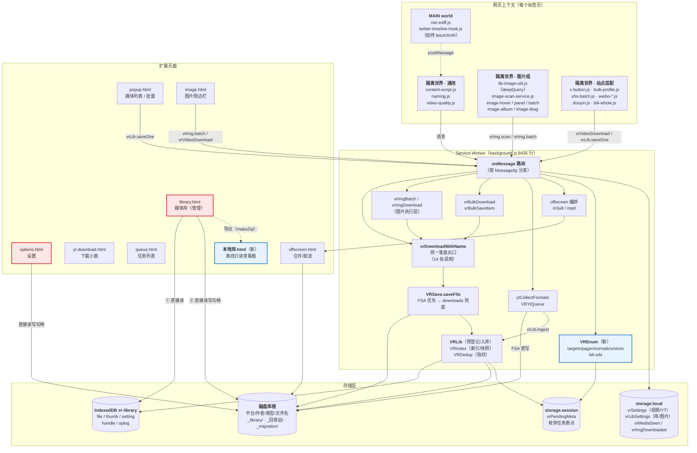
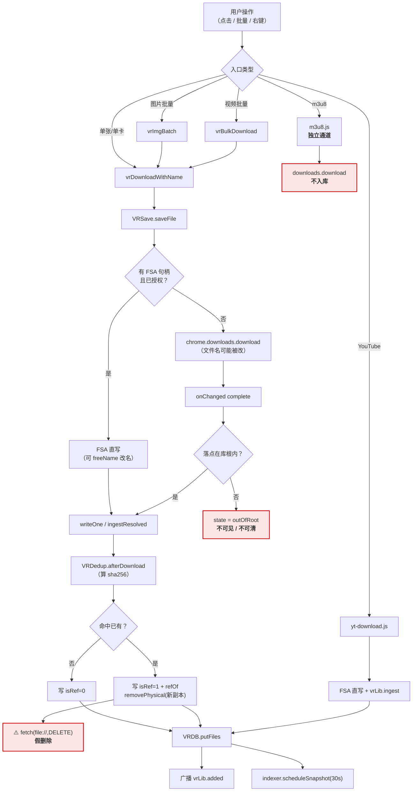
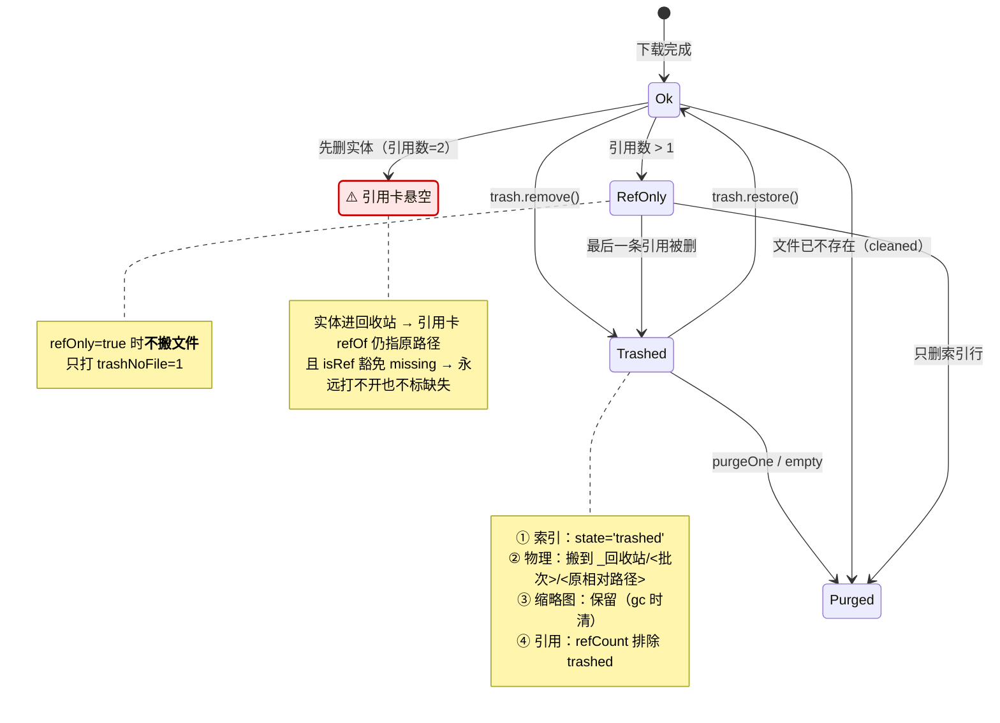
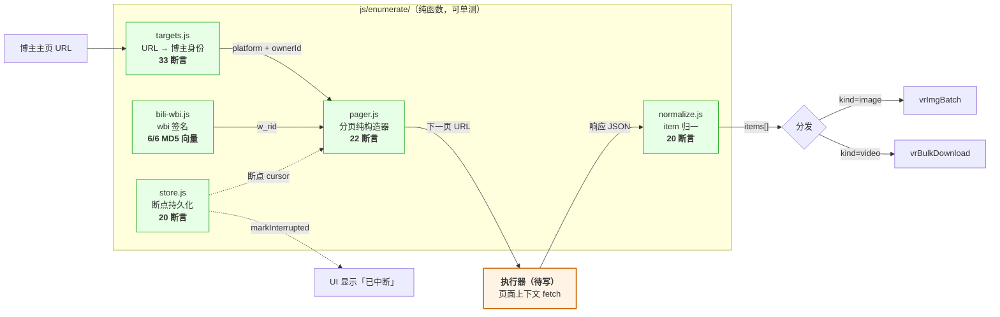
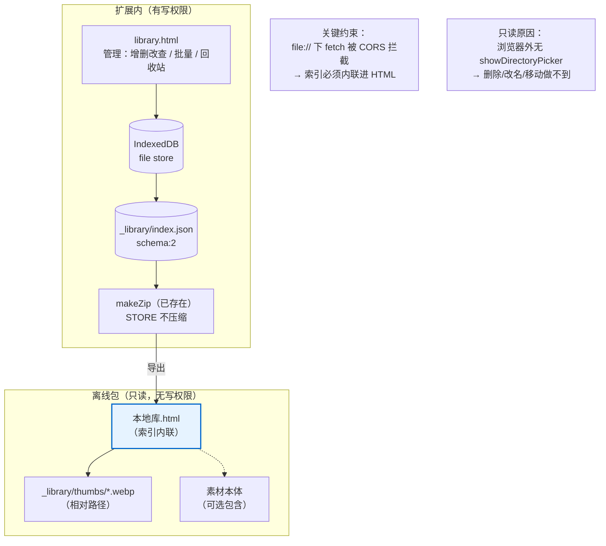
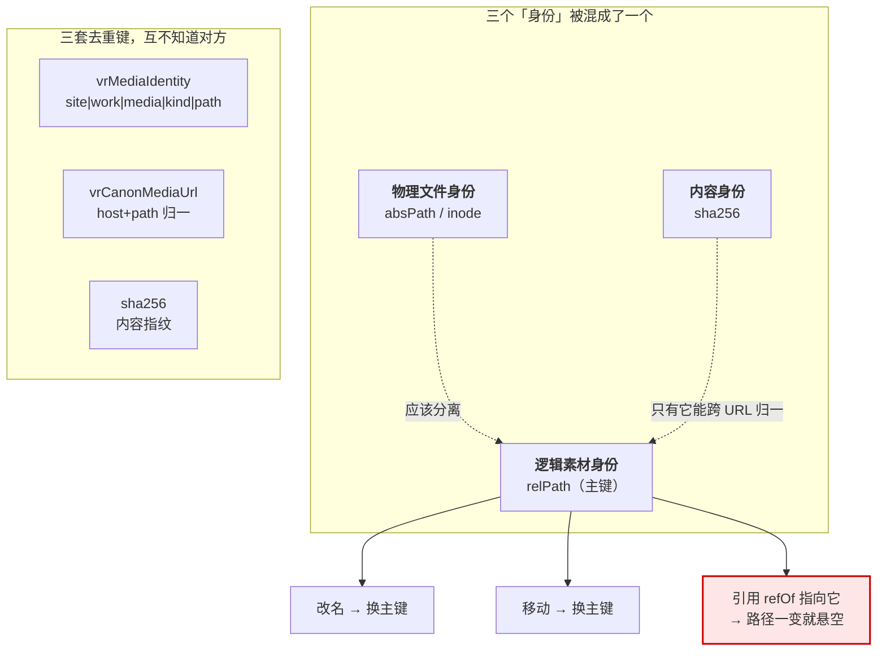

# video-rod 架构图（实测版）

> 日期：2026-11-18 ｜ **全部依据代码调用关系绘制，不依据文档**
> 配套：`ARCHITECTURE-HEALTH-AUDIT.md`（1004 行审计）｜`ENUMERATE-LAYER-DESIGN.md`（枚举层）
> 每张图下的「看图要点」指出**代码里的真实情况**（包括不一致处）

---

## 图 1 · 整体架构（运行时全景）

### 看图要点（**与文档说法不同的地方**）

| # | 代码事实 | 影响 |
|---|---|---|
| **1** | **红色框**：`library.html` 与 `options.html` **直接读写磁盘句柄，绕过 SW** | ADR-069「单写盘通道」只约束了下载，**没约束管理操作** |
| **2** | **「统一出口」只成立一半** | m3u8 独立页、YouTube 下载页、B站页面内合成、options 校验落盘，**四类不走 `vrDownloadWithName`** |
| **3** | **蓝色框**：`VREnum` 与 `本地库.html` 是**本轮新增**，尚未接线 | 枚举层只有纯函数，未接适配器 |
| **4** | **SW 与页面共享同一个 IndexedDB，但无跨上下文写锁** | `sw-library.writeQueue` 只在 SW 内串行 |
| **5** | `MAIN world` 用**点线**连接 | 它通过 `postMessage` 通信，不是直接调用 |

---

## 图 2 · 下载 → 落盘 → 入库（核心链路）

### 看图要点

| # | 事实 |
|---|---|
| **1** | **红色**：`removePhysical` 用 `fetch(file://,{method:'DELETE'})` —— 同仓库 `save.js:794` 明确写「返回 ok 但不删」 |
| **2** | **红色**：`outOfRoot` 条目**主页看不到、回收站不管、对账不清**（占盘但不可管理） |
| **3** | **红色**：`m3u8` 完全不入库（HLS 站点素材不进库） |
| **4** | 同一次下载可能跑**两遍内容去重**：`writeOne` 一次、`vrImgContentDedupe` 一次 |

---

## 图 3 · 回收站状态机（四方一致性）

### 看图要点

| # | 事实 |
|---|---|
| **1** | **红色**：先删实体、后删引用 → 引用卡**永久悬空**，且因 `isRef` 豁免 `missing` 而**不显示缺失** |
| **2** | `VRDedup.onDelete` **全库零调用** —— 设计里的「删引用」入口从未接上，真实删除走 `trash.js` 自写的 `refCount` 判断 |

---

## 图 4 · 枚举层（本轮新增，未接线）

### 看图要点

| # | 事实 |
|---|---|
| **1** | **绿色全部完成**（95 条断言 + MD5 验证） |
| **2** | **橙色**：执行器未写 —— 它是「把 URL 变成响应」的那一步 |
| **3** | **关键**：`pager.js` 的 B站策略**必须配 `bili-wbi.js`**，否则 `-352` 必失败 |

---

## 图 5 · 离线库（本轮新增）

### 看图要点

| # | 事实 |
|---|---|
| **1** | 导出能力**已存在**（`settings.js` `makeZip`），只缺 `本地库.html` |
| **2** | **蓝色**：离线页是新增，纯静态、零 `chrome.*` |
| **3** | 只读不是妥协，是**技术约束**（无写权限） |

---

## 图 6 · 数据模型与身份问题

### 看图要点

| # | 事实 |
|---|---|
| **1** | `relPath` **同时是**「主键」和「归档意图」——改路径等于改身份 |
| **2** | 三套去重键各写一套，**互不知道对方存在** |
| **3** | 这是「引用卡悬空」「改名要换主键」「三套键打架」的**共同根因** |

---

## 附：图与代码的对应表

| 图中元素 | 代码位置 |
|---|---|
| `vrDownloadWithName` | `js/background.js:770` |
| `VRSave.saveFile` | `js/library/save.js` |
| `writeOne` / `ingestResolved` | `js/library/sw-library.js:273` / `:207` |
| `VRDedup.afterDownload` | `js/library/dedup.js:180` |
| `removePhysical`（假删除） | `js/library/dedup.js:249` |
| `trash.remove` / `purgeOne` | `js/library/trash.js:477` / `:914` |
| `isRef` 豁免 missing | `js/library/indexer.js:1146` |
| `deepQuery`（Shadow DOM） | `js/lib-image-util.js:869` |
| `vrCanonMediaUrl` | `js/background.js:5493` |
| `vrImgRuleId`（DNR 单调） | `js/background.js:932` |
| `js/enumerate/*` | 本轮新增（95 断言） |
| `makeZip` | `js/library/settings.js:1031` |
