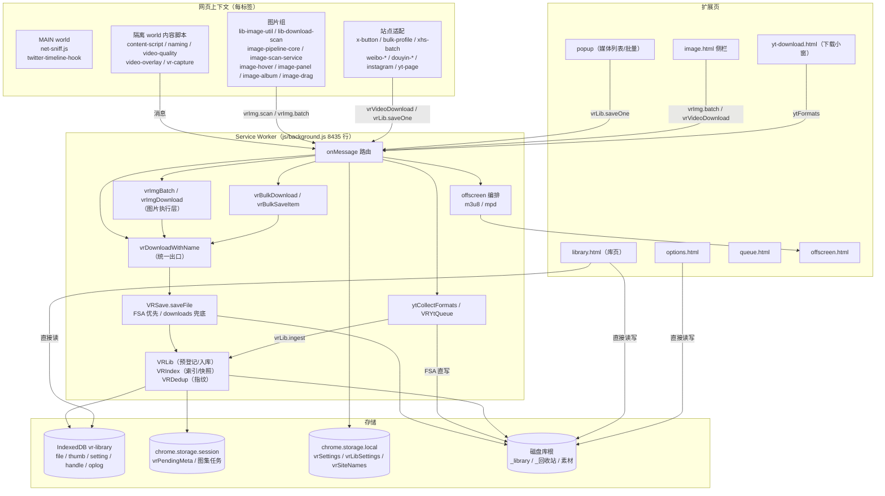
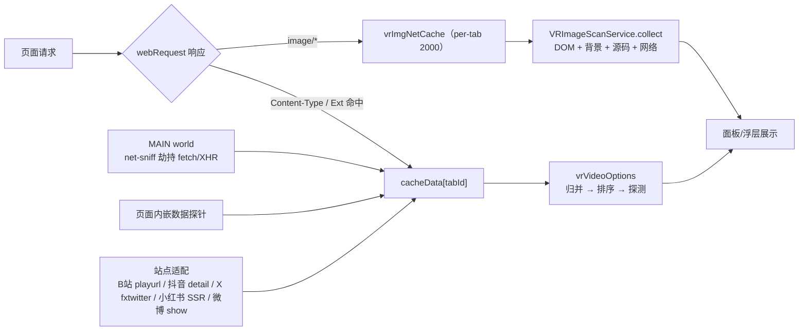
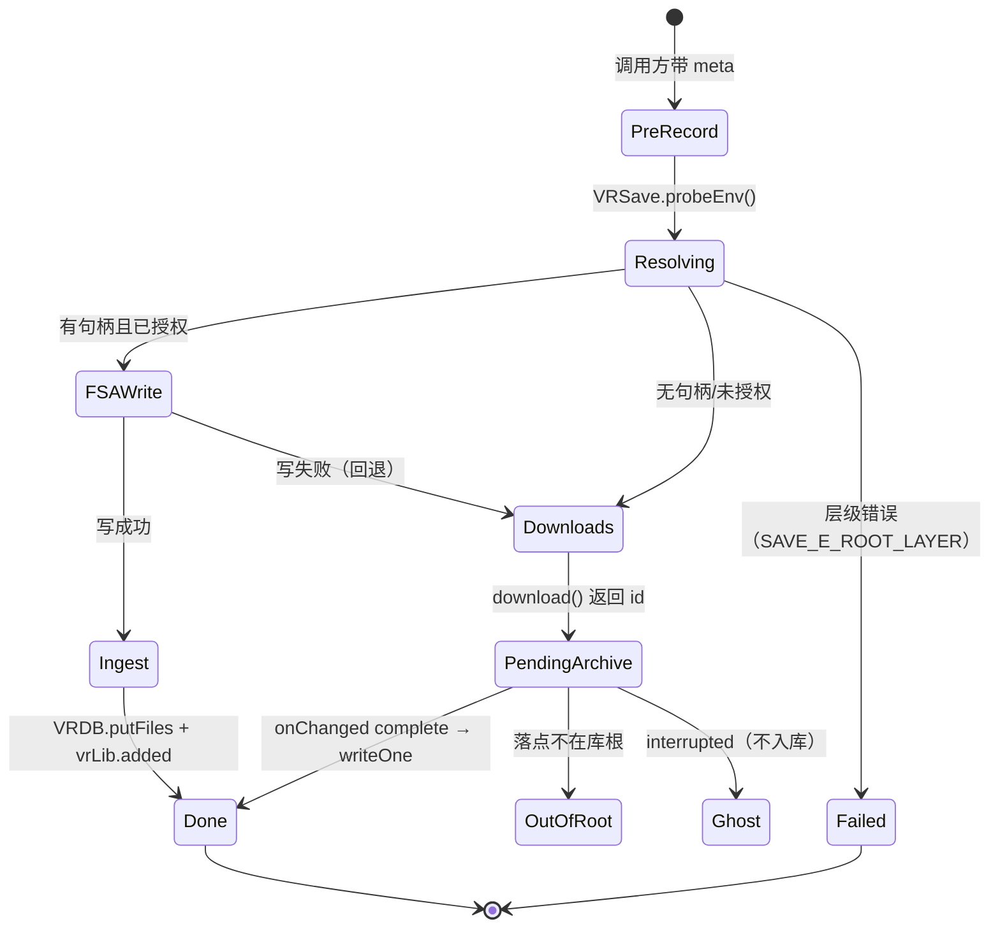
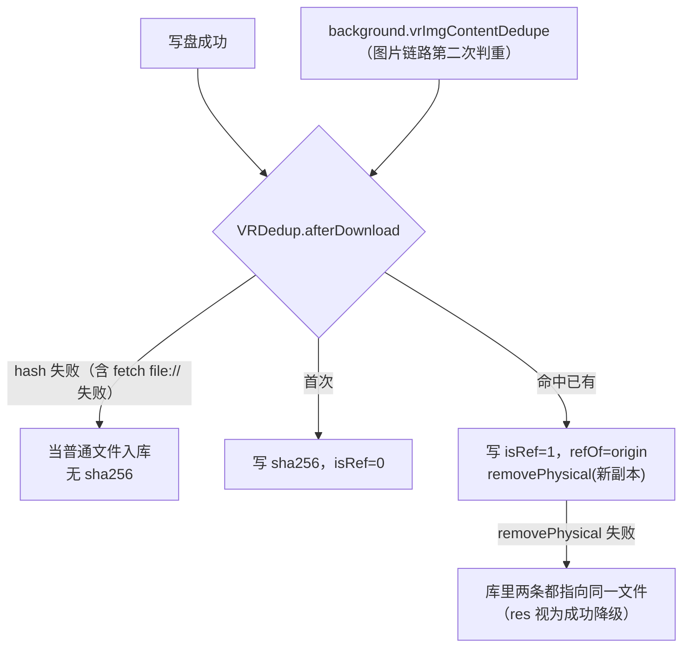
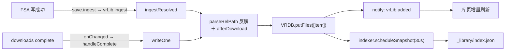
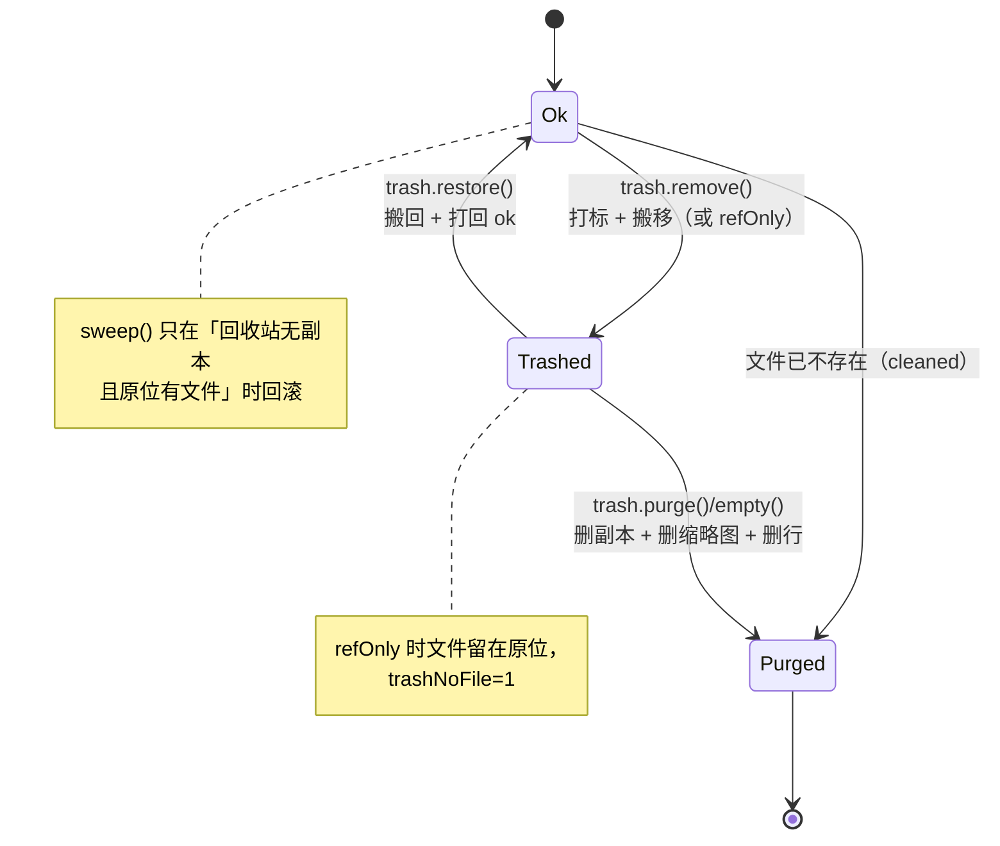
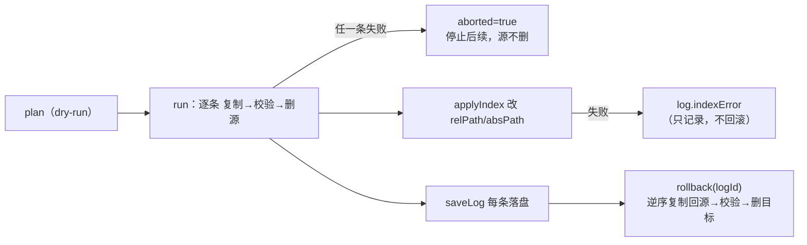
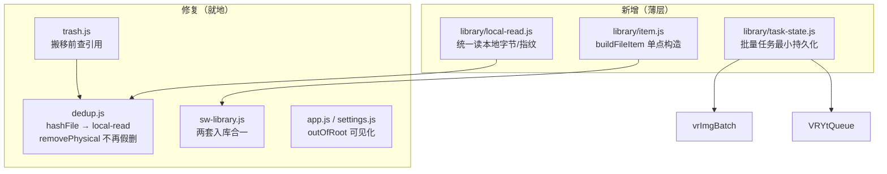

# 架构健康审计 · 苏哥的钓鱼竿（Video Rod）

> 审计人：独立第三方（不参与本项目开发）
> 日期：2026-11-17 ｜ 代码基线：`5f3e3148`（工作区另有 167 行未提交改动，见 §1.3）
> 方法：文档全量通读（70+ 份）+ 代码逐文件核对（核心模块）+ 单测实跑 + 隔离实例 E2E
> 铁律：**没有代码证据的不算缺陷**，标「待验证」；能局部修复的不提重构；不重画与现有代码无关的新系统。

---

## 〇、一页结论

**这个项目的核心架构是对的，问题不在设计方向，而在「同一件事有多套实现」与「状态真源不唯一」。**

三句话：

1. **产品判断成立**：「网页抓到 → 自动命名归档 → 入库可检索 → 记录溯源」这条链路，竞品没有一家走完（Eagle/Billfish 不会抓，猫抓不会管）。这是它值得继续投入的唯一理由，也是不该被重构掉的部分。
2. **技术底座有真实质量**：43 个 Node 单测套件 / 约 1348 条断言全绿；`db.js`/`path.js`/`root-guard.js`/`naming.js` 这类纯逻辑模块边界清晰、可测性好；5 万条首屏 105ms 的窗口化渲染是真做出来的。
3. **真正的风险集中在四处**：① 逻辑素材身份＝物理路径（`relPath` 主键），导致「同一内容多来源」只能靠补丁维持；② 内容去重依赖 `fetch(file://)`，**实测可用但依赖「允许访问文件网址」开关**，关闭时静默失效且错误不可区分；③ 图片批量 / YT 队列状态纯内存，SW 重启即丢且无恢复入口；④ 文档（ADR/BACKLOG/README）与代码已出现系统性漂移，后来者按文档改会改错。

**最值得优先处理的三件事（详见 §9）**：
- **P0-1** 把「内容指纹」与「引用计数」收敛到一条链路，并验证 `fetch(file://)` 在 MV3 SW 里是否真能读盘（若不能，整个内容去重是空转）。
- **P0-2** 给批量任务（图片/YT）加最小可恢复状态，SW 重启后能如实告诉用户「任务中断」，而不是静默丢失。
- **P0-3** 修文档真源：ADR 重号、失效未标注、README 规模数字失真——这是所有后续改动的地基。

**绝对不该重构的部分**：`library/path.js`（路径与平台识别的唯一真源）、`library/root-guard.js`（库根判据）、`naming.js`（命名引擎）、`db.js`（IDB 封装）、`fmp4-merge.js`（零重编码合并）。它们已被大量单测与真机钉死，动它们等于把已知正确换成未知。

---

## 一、真实基线

### 1.1 规模与构成（实测，不采信 README）

| 项 | README 声明 | 实测 |
|---|---|---|
| Node 测试套件 | 30 个 / 1426 条断言 | **43 个套件**（42 个 `test-*.js` + `dedup-test.mjs`），`node` 实跑 **43/43 通过**；脚本内断言调用约 **1348** |
| E2E 脚本 | 34 个 | `tools/` 下 **45 个** `e2e-*`/`library-*-e2e`/`cdp-*-test` 脚本 |
| ADR | 85 条 | 实际编号到 **ADR-088**，但 **ADR-028~044 各出现两次**（见 §2.2） |
| 构建产物 | 4.9 MB / 172 文件 | `dist/` 由 `tools/build-dist.js` 生成，源码与 dist 当前**不一致**（见 §1.3） |
| 代码规模 | — | `background.js` 8435 行 / 406 KB；`library/app.js` 4495 行 / 238 KB；`library/` 共 34 个模块 |

> 断言数不一致本身不是缺陷，但它说明**「数字」在文档里被当成了质量证明**，而数字是会漂移的。报告后文一律用实测值。

### 1.2 运行时形态（从 manifest 与代码读出）

- Manifest V3，`background.service_worker = js/background.js`，**无 `type: module`**，全部靠 `importScripts` 串联（`js/background.js:7-20`）。
- 扩展页 13 个（`popup`/`options`/`library`/`image`/`preview`/`downloads`/`downloader`/`m3u8`/`m3u8-multi`/`mpd`/`json`/`offscreen`/`install`）。
- 内容脚本注入组 12 组，其中 `net-sniff` 与 `video-overlay` 是 `all_frames: true`，**其余全站组是 `all_frames: false`**（`manifest.json`）。
- `host_permissions` 为 `*://*/*` + `<all_urls>`，`permissions` 含 `webRequest`/`declarativeNetRequest`/`downloads`/`scripting`/`sidePanel`/`offscreen`/`unlimitedStorage`。
- 测试环境：**Edge 157**（`157.0.4341.60`）+ 固定 profile `D:/test/download/.edge-login-profile` + 端口 9480；隔离套件用独立 profile + 9490，加载 `dist/`。

### 1.3 一个必须先说清的事实：源码与发布物分叉

```
HEAD            5f3e3148  (2026-11-16)
工作区          js/background.js +167 行、js/yt/yt-queue.js 4KB→11KB、x-button.js/yt-page.js/yt-download.js 等共 16 个文件改动
dist/           构建于 2026-11-15 19:54（不含上述改动）
```

后果：

- **隔离 E2E 测的是 `dist/`**（`tools/e2e-all.py:203-253` 明确 `--load-extension=dist`），所以它**没有覆盖** 11-16/17 的 video/YT 改动。
- **真实登录态会话（9480）加载的是仓库根**（`tools/vr-session.py:34` `EXT = ROOT`），即**含未提交改动**的源码。
- 两套测试因此测的是**两份不同的代码**，而文档里把它们当成同一个「真机已验证」。

这不是「谁写错了」，而是**构建纪律与测试目标没有对齐**：`ARTIFACT-MANAGEMENT.md` §2.1 规定「浏览器只加载 dist」，但真实站点会话一直加载仓库根。审计结论必须带着这个前提读：**凡 11-15 之后的「真机通过」，只对仓库根成立；凡隔离套件，只对 dist 成立。**

---

## 二、文档与代码一致性

### 2.1 文档分级（沿用项目自己的 S/A/P/H，并逐条核对）

| 级别 | 文档 | 核对结论 |
|---|---|---|
| **仍可信** | `INTERFACE-CONTRACT.md`（大部分）、`DEDUP-REF-DESIGN.md`（原理）、`ARTIFACT-MANAGEMENT.md`、`DESIGN-SYSTEM-STAGE.md` | 字段与规则大体对得上；但契约里 `workId/authorUid/dlAt` 的「写入方」描述与代码不符（见 §2.3） |
| **部分过期** | `LIBRARY-PLAN.md`、`TESTING.md`、`BACKLOG.md`、`README.md` | 规划部分早已实现或改道；测试基线数字滞后；BACKLOG 中多条已关闭但正文仍写「待施工」 |
| **已被取代** | `MEDIA-VIEWER-PLAN.md`（Media Chrome 段）、`MEDIA-METADATA-PLAN.md`（`_index/meta.json` 段）、`BUILD-PLAN.md`/`PLAN.md`（执行地位被 `EXECUTION-PLAN-20261108` 取代）、`LIBRARY-IMPLEMENTATION.md`（`_index/index.json` 段） | 这些文档**自己已标注**「已过时/以 XX 为准」，属诚实留痕，不是缺陷 |
| **仅历史** | `HANDOFF-*`、`INVENTORY-*`、`E2E-AUDIT-*`、`FIRST-RUN-AUDIT-*`、`STATUS-*`、`MERGE-*`、`TODO-VERIFIED.md` | 只作「为什么这么定」的证据，不能当现状 |

### 2.2 ADR 系统的结构性问题（**这是文档层的头号缺陷**）

**问题 1：编号重号，两套内容共用同一段号。**

`DECISIONS.md` 中 ADR-028~044 出现了两遍：

- 第一套（2026-10-18/19）：多段合并、B站完整视频、页内悬浮按钮、抖音取流、服务端代理、微博/X 批量、YouTube 调研、媒体库、小红书、去重、侧边栏、目录记忆、F 盘根、Instagram、YouTube 入口移除、小红书去后缀。
- 第二套（2026-10-24）：复用策略、产出物边界、索引三源、设置页 IA、资源库视觉、回收站、批量选择、Referer/DNR、并发池、去重账本、Tubly、YouTube 高清、FSA 落盘、尺寸档位、面板队列、内联输入、FSA 入库。

后果：代码注释里写「见 ADR-028」时，读者无法判断指的是「多段合并」还是「复用策略」；`BACKLOG` 里「ADR-050 已批 R1/R2」这类引用也可能指向错误条目。ADR-049 自己就记录了「初版误编为 045，撞号」——说明作者知道问题，但只修了 049，没修 028~044。

**问题 2：失效/被替代未标注。**

| ADR | 原决策 | 现状 | 应标 |
|---|---|---|---|
| ADR-018/021 | 合并走在线 FFmpeg（远程服务） | 被第二套 ADR-028（离屏直连 + mux.js）取代 | 已作废 |
| ADR-019 | YouTube 降级、不投入对抗 | 被 ADR-039 部分推翻；ADR-043 又「彻底移除入口」 | 部分作废 |
| ADR-043 | YouTube 入口彻底移除 | `js/yt/` 完整存在、manifest 有注入、`popup` 有下载页 | **与代码直接矛盾** |
| ADR-033（第二套） | 软删除到 `_回收站`、清单为真源 | 被 ADR-074 改为「索引状态为真源」 | 已修订 |
| ADR-034 | 批量选择只改 class、不做批量重命名 | 现 `app.js` 有批量操作、`rename.js` 支持单条 | 部分过时 |
| ADR-040 | `onDeterminingFilename` 在 Chrome 147 失效 → 改 FSA | 成立，但**存量 downloads 路径未迁**（§3.5） | 需补「未完成」 |

**问题 3：文档没有「最后核对日期」，且没有自动检查。**

`DOC-INDEX.md` 有分级表，但每份文档没有「最后与代码核对日期」。`tools/check-doc-sync.py` 存在，但只做关键词/文件存在性检查，不检查行为语义。结果是：**文档说「已实现」，代码可能已改道；文档说「未做」，代码可能已做完**（`TODO-VERIFIED.md` 自己就承认这一点）。

### 2.3 字段契约：读取方存在，写入方缺失

`INTERFACE-CONTRACT.md` §3 声称 `workId`/`authorUid`/`dlAt` 等溯源字段会落库。实测：

| 字段 | 读取方 | 写入方（实测） |
|---|---|---|
| `pageUrl` | `app.js`/`lightbox.js` 渲染 | ✅ `sw-library.writeOne`、`ingestResolved`、`save.ingest` |
| `sourceUrl`/`mediaUrl` | 查重与展示 | ✅ 同上 |
| `workId` | `lightbox.js:609` 显示、`app.js:171` | ❌ **`sw-library`/`save`/`ingest` 均不写**；只有 `mergeEntry` 会「保留旧值」 |
| `authorUid`/`authorHandle` | `app.js:174-175` | ❌ 同上，从不写入 |
| `dlAt` | `app.js:170`（读 `e.dlAt`，但实际用的是 `mtime`） | ❌ 不写；`writeOne` 用的是 `d.endTime` 写进 `mtime` |

后果：README 宣称的「作品 ID / 溯源四态徽标」在**新下载**里也只能靠目录名反推；「已记录/部分记录」的判定实际上只区分「有没有 pageUrl 和 直链」。这不是显示 bug，是**字段契约没落到写入方**——典型的「加字段时只改了读取和文档，没改三条写入链路」。

### 2.4 README 的对外表述与实现不符

| README 说 | 实际 |
|---|---|
| 「三层防重：URL 账本 → 平台去重 → 下载后 SHA-256」 | 三层都存在，但 §3.2 会说明它们是**三套独立逻辑、互不知道对方**，且 SHA-256 层有可用性疑问 |
| 「回收站：软删除、按原相对路径恢复、彻底删除、清空」 | 成立，但「引用式删除」与「批量引用回收」存在孤儿风险（§4.2） |
| 「索引维护：快速扫描 / 全量扫描 / 重建 / 缺失校对」 | 成立；`reconcile` 是独立模式，不是「重建」的一部分 |
| 「扩展自备份」 | 成立（`_library/` 导出），但依赖 FSA 授权，未授权时无入口 |

**判断**：README 的「产品叙事」基本成立，但「工程叙事」（数字、已实现清单）不可作为验收依据。建议 README 只保留产品层，工程数字移到一份自动生成的 `docs/STATUS-GENERATED.md`。

---

## 三、实测架构

### 3.1 运行时架构（按代码调用关系绘制，不按文档）



**关键事实（与文档不同的部分）**：

1. **「统一出口」只有一半成立**。`vrDownloadWithName` 确实是视频/图片/右键的出口，但 **m3u8 独立下载器、YouTube 下载页、B站页面内合成、options 的「校验落盘」** 四类不经过它（`m3u8.js:934/1955`、`yt/yt-download.js:747`、`bili-whole.js`、`settings.js:794`）。
2. **库页同时是 IDB 读者与磁盘写者**。`library.html` 直接读 IndexedDB，又通过 FSA 句柄直接改磁盘（删除/移动/改名/迁移），**没有经过 SW**。这意味着「单写盘通道」（ADR-069）只约束了下载，没有约束管理操作。
3. **图片补丁层在运行时改写全局函数**（`image-pipeline-patch.js`）：它 monkey-patch `vrImgBatch`、`vrImgSubdir`、`vrEntryFileAlive`、`vrImgNetAdd`，还给 `VRDB.getAllFiles` 加了 1.2 秒缓存。文件头注释直言原因是「`background.js` 被并行会话占用，不能硬改」。这是**协作产物**，不是设计。
4. **SW 与页面共享同一个 IndexedDB**，但没有跨上下文写锁。`sw-library.writeQueue` 只在 SW 内串行；库页与 SW 可能同时写同一条 `relPath`。

### 3.2 模块职责边界（哪些清楚、哪些含糊）

| 模块 | 职责 | 评价 |
|---|---|---|
| `js/library/path.js` | 相对路径拼装/解析、平台识别、file:// URL | ✅ **边界最干净**，纯函数 + 单测 |
| `js/library/root-guard.js` | 「库根是哪一层」的唯一判据 | ✅ 2026-11-14 收敛，三条入库通道共用 |
| `js/naming.js` | 页面识别 → 标题/作者 → 模板 → 清洗 | ✅ 纯函数、Node 可测 |
| `js/library/db.js` | IndexedDB 封装 | ✅ 薄、无业务 |
| `js/library/dedup.js` | 指纹 + 引用计数 | ⚠️ **职责与实际使用不符**（§3.3） |
| `js/library/sw-library.js` | 下载完成入库 + 预登记 | ⚠️ 同时承担「去重」「快照触发」「广播」三件事 |
| `js/library/indexer.js` | 三源扫描 + 快照 | ⚠️ 1512 行，扫描/合并/快照/状态四合一 |
| `js/background.js` | 下载、命名、平台适配、入库编排、YT、DNR、离屏 | ❌ **8435 行，无清晰边界**，是所有问题的交汇点 |
| `js/image-*` | 图片发现/下载/面板 | ⚠️ 四入口部分共用，部分各写（§3.4） |

### 3.3 dedup.js：一个「设计正确但没被接入」的模块

`js/library/dedup.js` 定义了完整的引用制语义：

- `afterDownload()`：下载后算指纹，命中已有则写 `isRef=1` + `refOf`。
- `onDelete()`：**删除＝只减引用，最后一条引用清空才删物理文件**。
- `refCount()`：按 `sha256` 数活跃条目。
- `compact()`：存量整理，把同指纹的多份物理文件合并为一份。

**实测调用情况**：

| 函数 | 被谁调用 |
|---|---|
| `afterDownload` | ✅ `sw-library.writeOne`、`ingestResolved` |
| `refCount` | ✅ `trash.remove` |
| `hashFile` | ✅ `background.vrImgContentDedupe`、`hashMissing` |
| **`onDelete`** | ❌ **全库零调用** |
| `compact` | ✅ `app.js`「扫描重复」 |
| `renameDisplay` | ✅ `rename.js`（引用条目改名） |

也就是说：**设计里的「删引用」入口从未接上**，真实删除走的是 `trash.remove` 内部一段**自写的引用判断**（`trash.js:550-561`）：

```js
var cnt = await root.VRDedup.refCount(entry.sha256);
if (cnt > 1) { refOnly = true; }
```

这段判断与 `onDelete` 的语义**看似相同、实则不同**：

- `refCount` 排除 `trashed` 与 `outOfRoot`（`db.js:305`），所以「活跃引用数」是对的。
- 但 `refOnly` 时它**不搬文件**，只打 `trashNoFile=1`；随后该条目的 `purgeOne` 只删「回收站副本」（而副本根本不存在）和索引行。
- **原件由谁删？** 只有当「删的是最后一条活跃引用」时，才走物理搬移。如果用户先删引用卡、再删实体卡，实体卡删除时引用数已降为 1，会正常搬移——这条路径是通的。
- **反之**：如果用户先删实体卡（此时引用数 2，`refOnly=false`），文件被搬进回收站，引用卡的 `refOf` 立刻指向一个**已不在原位的路径**。此时引用卡仍在主页，点开必然"文件缺失"；`indexer` 对 `isRef` 条目豁免 missing，所以它不会变灰，会成为一张**永远打不开的卡**。

> **这是 P0 级的数据一致性缺陷**，但需要实测确认（我未在真机复现）。代码证据：`trash.js:584-599` 搬移只在 `!refOnly` 时执行；`dedup.js:290` `refOf` 指向 `origin.relPath`；`indexer.js:1146-1149` 对 `isRef` 不判 missing。

### 3.4 图片管线的「四入口」实际收敛程度

文档（ADR-080）称「发现层与执行层各一份，四入口只做 UI」。实测：

| 入口 | 扫描 | 下载 |
|---|---|---|
| 侧栏 `image.html` | `U.scanImages`（本地）+ `vrImg.scan`（补注入） | `vrImg.batch` / `vrImg.download` |
| 面板 `image-panel.js` | `VRImageScanService.collect`（有则用），否则 `U.scanImages` | `VRImgBatch.download` → `vrImg.batch` |
| 悬停 `image-hover.js` | 不扫描（只取当前 img 的候选） | `vrImg.download` |
| 批量 `image-batch.js` | `U.scanImages`（**直接调用，不走 Service**） | `vrImg.batch` |

**结论**：执行层基本收敛（都到 `vrImgDownload`），**发现层没有完全收敛**——`image-batch.js:403` 与 `image-page.js` 仍直接调 `U.scanImages`，只有 `image-panel` 和 `popup` 走 `VRImageScanService`。这解释了为什么「同一页四入口数量不一致」的历史问题会反复出现。

### 3.5 落盘通道盘点（这是「归档不一致」的根因）

| 通道 | 入口 | 命名 | 归档 | 入库 | 失败回滚 |
|---|---|---|---|---|---|
| FSA 直写 | `VRSave.saveFile` | ✅ 真实 relPath（`freeName` 可改名） | ✅ 库根内 | ✅ `ingest` | ✅ 写失败 abort + 删半成品 |
| downloads 兜底 | 同上 | ⚠️ 名字可能被浏览器改 | ⚠️ 可能落 Downloads 根（`outOfRoot`） | ✅ `writeOne` | ⚠️ 先受理后失败 |
| 离屏 blob | `vrOffscreenDownload` | ⚠️ `<a download>` 只认名字 | ❌ 不支持子目录 | ✅ 预登记 meta | — |
| YouTube 下载页 | `yt-download.js:save` | ✅ FSA 优先 | ✅ | ✅ `vrLib.ingest` | ✅ abort |
| m3u8 独立页 | `m3u8.js` | ✅ 自己的命名 | ❌ 只在下载页 | ❌ **不入库** | — |
| B站页面内合成 | `bili-whole.js` | ✅ | ⚠️ `<a download>` 无目录 | ✅ 预登记 | — |

**判断**：**6 条通道、4 套命名/归档语义**。这是「不同入口下载成功率、命名规则、归档结果不一致」的直接原因。不需要全部合并（m3u8 与 YT 的合并流程确实独立），但**入库与去重必须共用一套**——目前 m3u8 完全不入库，是最大的例外。

---

## 四、核心数据模型与生命周期

### 4.1 数据模型（真实，不是文档版）

```
IndexedDB vr-library（version 1）
├── file    keyPath = relPath        ← 逻辑素材身份 = 物理路径
│     字段: relPath / absPath / platform / platformName / creatorFull / creatorId
│           type / fileName / size / mtime / mime / sourceUrl / mediaUrl / pageUrl
│           title / displayName / starred / tags / state / downloadId
│           sha256 / hashKind / isRef / refOf / width / height / duration
│           thumbKey / thumbFile / thumbSrc / pendingArchive / outOfRoot
│           trashBatch / trashedAt / trashNoFile / trashPending / untracked
│     state ∈ { ok, missing, trashed, outOfRoot }
├── thumb   keyPath = thumbKey       ← blob（与磁盘 _library/thumbs/*.webp 双写）
├── setting keyPath = key            ← 含 vrFavs、rootAbs、rootPrefix、migrateLog:*
├── handle  keyPath = key            ← FSA 目录句柄（root）
└── oplog   keyPath = id (autoInc)   ← 只写不读
```

### 4.2 三个「身份」被混成了一个

| 概念 | 代码里的表示 | 问题 |
|---|---|---|
| **物理文件身份** | `absPath` / 磁盘 inode | 只有它是唯一的 |
| **逻辑素材身份** | `relPath`（主键） | 它同时是「归档意图」和「主键」，改名/移动就换身份 |
| **内容身份** | `sha256` | 只有它能让「不同 URL、不同平台、同一文件」归一 |

后果链：

1. **重命名**必须换主键（`rename.js:286-289` 先写新 key 再删旧 key），迁移期间若有并发读者，会读到两条或零条。
2. **移动**同理（`move-picker.js:191-200`）。
3. **多来源同内容**只能靠 `isRef` + `refOf` 这条**单向指针**维持；一旦原件被搬走/删除/改名，引用卡就悬空。
4. **去重键**不得不在三处各写一套：`vrMediaIdentity`（批量）、`vrCanonMediaUrl`（图片）、`sha256`（内容）。三者互不知道对方存在。

### 4.3 六条核心数据流

#### 流 1：媒体发现与识别



问题点：
- **视频与图片走两套发现通道**（视频靠网络响应，图片靠 DOM+网络缓存），两者的「去重键」也不同。这是设计使然，但 UI 上被并列展示，用户以为是一套。
- `vrVideoOptions` 每次调用都会做「归并 + 探测（Range 0-1）」，批量时会重复探测同一 URL（无跨调用缓存）。

#### 流 2：下载任务生命周期（FSA 优先）



问题点：
- `downloads` 分支是**「先受理后异步失败」**：`saveDownloads` 在 `api.download` 回调里就返回 `ok:true`，真实失败要等 `onChanged`。popup 用 20 秒看门狗兜，但**其他调用方（右键、离屏、图片单张）没有同等看门狗**。
- `Ghost` 状态不是显式状态，只是「不入库」；如果磁盘上留了 0 字节残件，`vrDiscardBadDownload` 只处理 `complete`，不一定清理 `interrupted` 残件。

#### 流 3：物理文件保存与去重



**这里有两个结构性问题**：

1. **同一件事判两遍**：`sw-library.writeOne` 已调 `afterDownload`；图片链路在 `vrImgDownload` 里又调 `vrImgContentDedupe`，后者内部再调 `hashFile` + `findByHash` + `patchFile` + `removeFile`。两处语义并不完全一致（后者会 `patchFile` 回滚、前者不会）。
2. **`removePhysical` 用 `fetch(file://, {method:'DELETE'})`**（`dedup.js:249-257`），而**同仓库 `save.js:794-796` 与 `image-pipeline-patch.js:89-93` 都明确写过「`fetch(file://)` 的 DELETE 返回 ok 但根本不删」**。这意味着 `afterDownload` 命中重复时的「删除新副本」很可能是**假删除**：库说引用、盘上留了两份。
   - 真实删除由 `vrImgContentDedupe` 走 `VRSave.removeFile`（FSA），所以**图片链路是安全的**；但 `sw-library.writeOne` 这条（视频/批量）不安全。
   - 更根本的问题：`hashFile` 也依赖 `fetch(file://)` 读文件。如果 MV3 SW 根本不能 fetch `file://`，那么 `hash` 恒为空，`afterDownload` 等于空转，**所有视频的内容去重都不生效**。这一点必须实测（§9 P0-1）。

#### 流 4：媒体库入库



问题点：
- `ingestResolved` 与 `writeOne` 是**两份几乎相同但不完全相同的代码**（字段兜底、去重时机、平台兜底各写一遍）。这是「字段在某一条路径上丢失」的温床（`mediaUrl` 就曾这样丢过）。
- `scheduleSnapshot` 依赖 `VRIndex` 已加载；`background.js` 用 `try/importScripts` 兜底，但如果加载顺序变化，快照会静默不写。

#### 流 5：删除与恢复



问题点（详见 §5.2）：引用卡与实体卡的删除顺序会决定文件是否孤儿；`purgeOne` 不追 `refOf`；`dropDeadCards` 在 `empty()` 时激进（`includeMissing:true`）。

#### 流 6：迁移与索引重建



问题点：`applyIndex` 失败时文件已搬、索引未改，**没有自动修复入口**；`rollback` 依赖 `log.srcHandle/dstHandle`，句柄跨会话可能失效。

---

## 五、架构问题清单

> 每条固定格式：**问题 / 涉及模块 / 文件与函数 / 调用关系 / 代码证据 / 成因 / 影响 / 修改必要性**。
> 「待验证」表示我未在真机复现，但代码路径指向该结论。

### 5.1 P0：数据安全与文件丢失

#### P0-1 内容去重的真实前提：**依赖「允许访问文件网址」开关**（已实测）

- **涉及**：`library/dedup.js`、`library/sw-library.js`、`background.js`
- **文件/函数**：`dedup.hashFile()`（`dedup.js:128-158`）→ `openSource()`（`:97-122`）→ `fetch(url)`；调用点 `sw-library.writeOne`（`:349-356`）、`ingestResolved`（`:238-245`）
- **实测结论（2026-11-17，Edge 157，`tools/probe-sw-file/`）**：

  ```
  allowed: true                      ← chrome.extension.isAllowedFileSchemeAccess()
  fetch('file:///C:/Windows/win.ini') → status 200, 92 bytes   ✅ 能读
  fetch('file:///C:/不存在.txt')       → "Failed to fetch"      ← 错误不可区分
  verdict: fetch(file://) 可用
  ```

  **`fetch(file://)` 在 MV3 SW 中确实可用**，但**前提是扩展被授予「允许访问文件网址」**。这推翻了我此前「内容去重可能整体空转」的假设。

- **但实测同时暴露了两个真问题**：

  1. **这个开关默认关闭**。探针的 `allowed: true` 是因为测试环境手动开了。真实用户没开时，`hashFile` 全部失败，而失败被静默吞掉（`afterDownload` 当作「首次」），**用户无法感知内容去重已经失效**。
  2. **错误不可区分**：读不到文件时统一是 `"Failed to fetch"`，代码无法判断「文件不存在」（该标 missing）还是「没权限」（该提示开开关）。这正是 `image-pipeline-patch.js:89-93` 改用 FSA 句柄探盘的原因。

- **`removePhysical` 的假删除仍然成立**：`fetch(file://, {method:'DELETE'})` 返回 ok 但不删——这是 HTTP 语义问题，与能否读取无关，**不会因为本探针通过而消失**。

- **成因**：三条链路各用一套「读本地文件」的方法（`fetch(file://)` / FSA `getFile()` / 句柄 `getFileHandle`），没有统一；`dedup` 用了唯一**依赖用户开关**的那一条。
- **影响**：开关关闭时，视频/批量链路的内容去重静默失效，只留 URL 级去重。
- **修改必要性**：**中高**（从「极高」下调，因为已证实技术上可行）。
- **建议改法**：`hashFile` 前先查 `chrome.extension.isAllowedFileSchemeAccess()`；为 `false` 时**明确降级并在设置页显示**「内容去重不可用（需开启『允许访问文件网址』）」，而不是静默当首次。

#### P0-2 引用卡悬空：先删实体、后删引用

- **涉及**：`library/trash.js`、`library/dedup.js`、`library/indexer.js`
- **文件/函数**：`trash.remove()`（`:477-653`）的 `refOnly` 分支；`dedup.onDelete()`（**未调用**）；`indexer.build()` 对 `isRef` 的豁免（`:1146-1149`）
- **证据**：
  - `trash.js:550-561`：`refCount(entry.sha256) > 1` 才 `refOnly=true`。
  - `trash.js:584-599`：`!refOnly` 时搬文件进回收站；`refOnly` 时不动文件。
  - `dedup.js:290`：引用条目的 `refOf` 指向 `origin.relPath`。
  - `indexer.js:1146-1149`：`isRef` 条目扫不到时「保持原样」，不标 missing。
- **成因**：引用制的「删除顺序无关性」没有被保证。设计假设「先删引用、最后删实体」，但 UI 允许任意顺序。
- **影响**：先删实体 → 文件进 `_回收站`；引用卡仍指向原 `relPath`，点开 403/缺失，且因为 `isRef` 豁免不会显示「文件缺失」。用户看到一张**永远打不开的卡**。
- **修改必要性**：**高**。属于静默数据损坏。
- **需要**：在 `trash.remove` 搬移前检查「是否有引用条目指向我」，若有则**把所有引用条目的 `refOf` 重指到回收站路径**，或禁止先删实体（UI 层提示「该素材有 N 条引用，删除后引用将失效」）。
- **待验证**：真机复现一次「下载同图两源 → 删实体 → 打开引用卡」。

#### P0-3 `outOfRoot` 条目占盘但不可见、不可清

- **涉及**：`library/sw-library.js`、`library/indexer.js`、`app.js`
- **文件/函数**：`writeOne` 的 `pendingArchive → outOfRoot`（`:298-346`）；`app.load()` 过滤 `outOfRoot`（`:1294-1303`）；`dropDeadCards` 跳过 `outOfRoot`（`trash.js:391-401`）
- **证据**：`sw-library.js:343-345` 写 `pendingArchive=1; outOfRoot=1; state='outOfRoot'`；`app.js:1303` 从主页过滤；`trash.js:401` 在对账时跳过。
- **成因**：为了堵「上级目录被吸进库」的漏洞，引入了 `outOfRoot` 状态；但它没有对应的「用户可见 + 可清理」入口。设置页只显示「库外 N 条（不计入）」（`settings.js:133`）。
- **影响**：文件在磁盘上真实存在、占空间，但主页看不到、回收站不管、对账不清。用户只能靠资源管理器手动找。
- **修改必要性**：**中高**。不是丢数据，是「数据不可管理」。
- **建议**：给一个只读列表 + 「移入库根」/「仅删索引」两个动作；不要自动删。

### 5.2 P1：状态不一致与链路冲突

#### P1-1 三套去重键互不知道对方

- **证据**：`background.vrMediaIdentity`（`:5692`，`site|workId|mediaId|kind|origin+pathname`）、`vrCanonMediaUrl`（`:5493`，host+path 归一）、`dedup.sha256`。
- **影响**：同一条内容可能被三层中的任意一层拦住，也可能三层都漏（例如「换了 CDN 域、换了作品 ID、采样指纹不同」）。
- **判断**：不要求合并成一套（三层各有适用面），但**必须有一个「谁是权威」的裁决**。建议：URL 级只做「同批内快速跳过」，内容级做「最终裁决」，平台级只做「作品级防重复」。

#### P1-2 图片批量 / YT 队列状态纯内存，SW 重启即丢

- **证据**：`VR_IMG_BATCH = new Map()`（`background.js:1696`）、`VRYtQueue` 内存数组（`yt-queue.js:48-51`）；`YT-DELIVERY-REPORT.md` 明确写「一期不做持久化」。
- **影响**：SW 被回收后，正在跑的批次静默停止；用户看到进度条停住，没有任何「已中断」提示，也没有续跑入口。图片侧靠 content 侧 60s 超时兜底，但只报「中断」不恢复。
- **修改必要性**：**高**。这是「下载稳定性」的核心。

#### P1-3 `image-pipeline-patch.js` 是运行时补丁，不是设计

- **证据**：文件头注释（`1-11`）自述「background.js 被并行会话占用，不能硬改，于是在运行时包装」；它 monkey-patch 了 5 个全局函数，并给 `VRDB.getAllFiles` 加 1.2s 快照。
- **影响**：
  - 行为依赖「`background.js` 求值完成后再执行补丁」的时序（`setTimeout(install, 0)` + 最多 20 次重试）。
  - `getAllFiles` 的 1.2s 缓存会让「刚入库的条目在查重时不可见」，与 `batchSeen` 的注释（「同批新入库的重复由…兜底」）互相依赖。
  - 任何人读 `background.js` 都看不到这些行为，**维护成本高**。
- **修改必要性**：**中高**。不建议立刻拆（风险大），但应在文档中显式登记，并在下一次修改 `background.js` 时把补丁内容合并回去。

#### P1-4 同一份「入库字段构造」有两套

- **证据**：`sw-library.ingestResolved`（`:207-271`）与 `sw-library.writeOne`（`:273-390`）字段几乎相同；`save.ingest`（`:619-665`）又构造一遍。
- **影响**：`mediaUrl` 曾在 `ingest()` 丢失（ADR-060）；`workId/authorUid/dlAt` 至今三条链路都不写（§2.3）。**下一次加字段还会漏**。
- **建议**：抽一个 `buildFileItem({rel, abs, d, meta, parsed})` 纯函数，三条链路都调它。这是低风险、高收益的局部重构。

#### P1-5 m3u8 通道完全不入库

- **证据**：`m3u8.js:934`、`:1955` 直接 `chrome.downloads.download`；`DOWNLOAD-PIPELINE.md:38` 自认「11–13 是历史遗留独立通道，本次不动」。
- **影响**：HLS 站点下载的素材不进资源库、不去重、不留溯源。而 HLS 恰恰是「视频流」的主战场。
- **修改必要性**：**中**。合并流程确实独立，但落盘/入库应复用 `VRSave` + `vrLib.record`。

### 5.3 P2：可维护性与体验

| # | 问题 | 证据 | 影响 |
|---|---|---|---|
| P2-1 | `background.js` 8435 行，下载/命名/平台/YT/DNR/离屏/入库全在里面 | 文件本身 | 改一处要读很久；本轮多个 bug（`ask` 未定义、`__fsa` 未判）都源于此 |
| P2-2 | `oplog` 只写不读 | `db.js:351`，全库无读取 | 审计日志形同虚设 |
| P2-3 | 设置分两个命名空间，图片设置两处入口 | `vrSettings` vs `vrLibSettings` | 改一边另一边可能不生效 |
| P2-4 | `image-batch.js` 与 `image-page.js` 不走统一扫描服务 | `image-batch.js:403` | 四入口数量不一致 |
| P2-5 | 缺失态与「引用」态在 UI 上不可区分 | `lightbox.js:568-569` 只判 `missing` | 用户无法判断「打不开」的原因 |
| P2-6 | README 工程数字与实测不符 | 43 vs 30 套件 | 对外可信度 |

### 5.4 已确认「不是问题」的（避免后续重复提案）

- **5 万条性能**：`app.js` 的窗口化（`PAGE=120` + `paintWindow`）实测首屏 105ms、DOM 49 节点，够用。不需要上虚拟滚动库。
- **IndexedDB 选型**：5 万条 20.6 MB、全读 833ms、索引查询 153ms，不是瓶颈。
- **纯函数模块**（`path`/`naming`/`root-guard`）：边界干净，有单测，**不要动**。
- **回收站的 `sweep()` 自愈**：逻辑复杂但方向正确（删除态权威），2026-11-13 的修复（ADR-085）是真修复。
- **`fetch(file://)` 的 DELETE**：已知不可靠，代码里已改用 FSA；**不要试图修 `fetch`**。

---

## 六、竞品技术借鉴（基于 12 家完整拆解）

> **数据来源已升级**：`docs/research/extensions/`（40 份 / 6910 行），含 12 家深度拆解 +
> 3 份协议级专文（AIX 62 条规则表、VDH 下载状态机、抖珍藏目录状态机）。
> **完整对照见 `docs/COMPETITOR-GAP-DIAGNOSIS.md`**（21 项已有 / 21 项缺口 / 4 项空白 / 8 项不用）。

### 6.1 总表：12 家各自最强的一项

| 扩展 | 最强项 | 我们是否已有 |
|---|---|---|
| **Fitkun** | 跨世界取值协议（315B `postMessage` + 路径字符串） | ✅ 已有（`executeScript` 够用） |
| **VDH** | **8 通道 RPC 枚举** + `_untrusted` 分层 | ⚠️ 我们参与者少 |
| **MAX** | `getContexts` 三级降级 + **DNR 规则按 jobId 回收** | ✅ 已有（`vrImgRuleId` 单调递增） |
| **Chrono** | **`HEAD` + `Range` 探测（206/200 分支）** | 🔧 **有缺口** |
| **AIX** | **62 条「缩略图→原图」规则表** | 🔧 **有缺口**（我们 5 站） |
| **爱哔哔** | B站清晰度码表 + `medialist` 合集 API | 🔧 合集缺、码表有 |
| **抖珍藏** | **整博主枚举 + `disappeared` + 目录 10 态** | 🔧 **核心缺口** |
| **Plucker** | XHR 被动拦截 + `navigation` API | ✅ 已有（方式不同） |
| **小金薯** | —（纯 DOM，无借鉴价值） | ✅ 我们更强 |
| **图片下载器4.0** | **3KB SW 全文** + `downloadId` 映射 | ✅ 已有 |
| **Imageye** | **Shadow DOM 递归** + 六模块拆分 | ✅ 已有（`deepQuery`） |
| **1.18** | `importScripts` 加载器 + 5 权限最小集 | ✅ 已有 |

### 6.2 权限与注入模型

| 产品 | 权限数 | 对我们的启示 |
|---|---|---|
| 抖珍藏 | **0**（空数组） | 靠页面上下文发请求，不需 `downloads`/`storage` |
| Plucker | 3 | 只做单站 |
| 1.18 | 5 | **正好是我们的最小子集** |
| VDH / AIX | 12 | 同我们量级 |
| **我们** | **20+** | 多站点通用嗅探的必然代价 |

**结论**：**不学抖珍藏/Plucker 的窄权限**（我们做通用嗅探）；但 1.18 的 5 项证明我们的额外权限都对应真实功能，**不是冗余**。

### 6.3 任务状态持久化

| 产品 | 做法 | 我们现状 |
|---|---|---|
| Chrono | `storage.session` + `finished_bytes`×19/`etag`×6/`checksum`×5/`resume`×2 | `store.js` 已按同字段设计 |
| MAX | `storage.session` + `local` **双写**（SW 重启可恢复） | 🔧 **只用 session** |
| Fitkun | `storage.session`×5 | — |
| Plucker/1.18/Imageye | **无持久化**（关了全丢） | 我们已优于它们 |

**结论**：已建 `store.js`（20 断言），**缺 `session`+`local` 双写**。

### 6.4 去重 / 引用语义

| 产品 | 做法 |
|---|---|
| 抖珍藏 | `masterList`（服务器全量）+ `downloaded` + **`disappeared`（服务器已删但本地有）** |
| AIX/Imageye | 按 URL 去重，无内容级 |
| Eagle / Billfish | 内容哈希，无引用计数 |

**结论**：我们的引用制仍是差异化设计；**但缺 `disappeared` 这个「备份价值核心」**。

### 6.5 失败与恢复

| 产品 | 做法 | 我们现状 |
|---|---|---|
| **VDH** | **`aborted_no_partial` 三态**（失败是否留垃圾） | ❌ **无** |
| Chrono | Range 206/200 探测 + 不支持自动降级 | 🔧 有 Range，无分支 |
| AIX | 图片失败候选回退 | ✅ 已有 |
| AIX | ⚠️ **`in_progress` 当 `success`**（反面教材） | ✅ 我们没犯 |

### 6.6 哪些我们做得更好（不要自我否定）

| 能力 | 我们 | 竞品 |
|---|---|---|
| **零重编码合并** | `fmp4-merge.js` ~20KB | 爱哔哔 30MB / MAX 7.2MB / VDH 4.7MB ffmpeg wasm |
| **FSA 直写库根 + 引用计数 + 回收站** | ✅ 完整 | **12 家无一实现** |
| **本地溯源元数据** | 三段溯源 | 普遍只存 URL |
| **自动归档 + 入库** | 抓+管+存一体 | Eagle 不会抓，猫抓不会管 |
| **Shadow DOM 递归** | `deepQuery()` | 与 Imageye 同算法 |
| **DNR 补 Referer** | ✅ | SnapHD 明确放弃 |
| **本地媒体库（75 按钮/95 函数/5 万条 105ms）** | ✅ | 抖珍藏壳是远端下发 |

---

## 七、工程质量实测

### 7.1 单测（实跑，2026-11-17）

```
for t in tools/test-*.js tools/dedup-test.mjs; do node "$t"; done
→ 43 个套件全部通过，0 失败
→ 脚本内断言调用约 1348 条（grep 统计，实际断言数略高）
```

**判断**：纯逻辑层的质量是真实的。但这**不等于系统质量**——因为：

- 单测覆盖的是**纯函数**（命名、路径、保存模式、去重键、图片扫描），不覆盖 `background.js` 的编排、`sw-library` 的两套入库、`trash` 的引用顺序。
- `dedup-test.mjs` 的 `fetch` 是 **stub**（`tools/dedup-test.mjs:14`），所以它**不能证明 `fetch(file://)` 在真实 SW 中可用**。这是 P0-1 至今没被发现的原因。

### 7.2 E2E（隔离实例，实跑）

- 命令：`python tools/e2e-all.py --isolated --only e2e-sw,dedup,e2e-popup`
- 结果：见 §7.4（后台执行，跑完回填）。
- **门禁覆盖缺口**：`cdp-trash-empty-repro`、`cdp-trash-full-rescan`、`cdp-trash-dup-index`、`library-move-e2e`、`library-integrity-check`、`migrate-relpath` 这些**回收站/迁移/完整性**脚本**不在 `e2e-all.py` 的 `SUITES` 里**（`e2e-all.py:41-56` 只有 14 个套件）。它们只在复盘文档里被手工跑过。
- **健康体检的「可以发」口径**：冒烟档只跑 `e2e-sw,dedup` 两个浏览器套件（`health-check.py:72`）。所以「9 项全绿 / 可以发」并不代表回收站、迁移、图片批量都验过。

### 7.3 性能与规模

- 5 万条：首屏 105ms、DOM 49 节点（`HANDOFF-2026-11-06-ROUND2.md` §16，`app.js` 窗口化）。
- 1 万条：`getAllFiles` 203ms、索引查询 53ms。
- **未实测**：真实库 5 万条压测（现有数据来自合成数据）；大文件（>1GB）合并内存峰值。

### 7.4 本轮实测记录

```
python tools/e2e-all.py --isolated --only e2e-sw,dedup,e2e-popup --reason "架构审计基线"
→ 批次汇总：3/3 套件通过，用时 53.8s
   PASS  e2e-sw      4/4    3.9s
   PASS  dedup       21/21  0.4s
   PASS  e2e-popup   8/8    39.8s
→ 隔离实例 port=9490 已关闭，真实 9480 未受影响
→ 报告：deliverables/test-runs/2026-11-17-2041-e2e-all.md
```

说明：
- 这三条是本轮**实际执行**的，不是引用历史记录。`e2e-popup` 的 8 条含「每行都有独立下载键 / 文件名输入框 / 目录 chip」——说明 popup 的逐条能力确实接上了。
- 收尾时 Python 读取子进程输出的线程报了 `UnicodeDecodeError: 'gbk' codec`，属**测试脚手架的编码问题**（Windows 控制台默认 GBK），不影响套件判定。但它本身是一个可登记的小缺陷：`e2e-all.py` 读取子进程输出时应统一 `encoding='utf-8', errors='replace'`。
- **未跑**：`cdp-trash-*`（3 个）、`library-move-e2e`、`library-integrity-check`、`migrate-relpath`。原因是它们不在 `e2e-all.py` 的 `SUITES` 里，需逐条手工调用；本轮受上下文预算限制未执行，报告中不把它们记为「通过」。

### 7.5 结论

**「1426 条断言全绿」是真的（数量略有偏差），但它证明的是纯逻辑正确，不是系统正确。** 系统层的关键风险（引用顺序、SW 重启、`fetch(file://)`、m3u8 不入库）恰好都在单测覆盖之外，且不在门禁里。

---

## 八、推荐架构（只写相对现状的变化）

> 原则：**保留 80%，修复 15%，重构 5%**。不重画。

### 8.1 完全保留（不动）

| 模块 | 理由 |
|---|---|
| `library/path.js` | 路径/平台唯一真源，90 条单测 |
| `library/root-guard.js` | 库根判据，40 条单测，2026-11-14 刚收敛 |
| `js/naming.js` | 命名引擎，61 条单测 |
| `library/db.js` | IDB 薄封装，改动面小、收益低 |
| `js/video-quality.js` | 清晰度排序/解析，100 条单测 |
| `js/yt/fmp4-merge.js` | 零重编码合并，21 条断言 |
| `css/` + `DESIGN-SYSTEM-STAGE.md` | 视觉已定稿 |

### 8.2 局部修复（最小改动，按优先级）

**修复 1：统一「读本地文件」的入口，验证并兜住 `fetch(file://)`**

```js
// 新增 library/local-read.js（约 60 行）
// 优先 FSA 句柄（页面/SW 均可持有句柄引用时）；否则 fetch(file://)；两者都失败返回 null
async function readBytes(absPath, relPath) { ... }
async function hashFile(absPath, relPath) { ... }   // dedup 改为调它
```

- `dedup.hashFile` 改为调 `local-read.hashFile`。
- 若 SW 中 `fetch(file://)` 不可用：退回「只对图片链路做内容去重（有 FSA）」，视频链路明确标注「无内容去重」。**不要假装有**。
- 同时把 `removePhysical` 改为「不再尝试删文件」，删除副本统一由调用方用 `VRSave.removeFile` 完成（图片链路已经这么做）。

**修复 2：引用删除加顺序保护**

在 `trash.remove` 的搬移分支前加一次检查：

```js
var refs = await root.VRDB.findBy('refOf', rel);   // 谁指向我
if (refs.length) {
  // 方案 A（推荐）：把所有引用条目的 refOf 改成「回收站路径」，并把它们标 isRef=1
  // 方案 B：拒绝删除，提示「有 N 条引用，请先删除引用」
}
```

- 推荐 A（不阻断用户），但需要 `restore()` 时反向恢复 `refOf`。

**修复 3：给批量任务加最小状态持久化**

- `VR_IMG_BATCH` / `VRYtQueue` 的关键字段（`batchId/total/done/ok/fail/status/startedAt`）每 10 项或 3 秒写一次 `chrome.storage.session`。
- SW 启动时读一次：若存在 `status='running'` 但无对应任务，标 `interrupted` 并在 UI 显示「上次批量已中断（完成 N/M）」，提供「重试失败项」。
- 不要求「断点续跑」（成本高、收益不确定），只要求**如实告知**。

**修复 4：`outOfRoot` 可见化**

- 设置页「库外 N 条」点开 → 只读列表（relPath / absPath / 大小 / 时间）。
- 两个动作：「移入库根」（走 `migrate` 的单文件版本）/「仅删索引」。
- 不自动删文件。

**修复 5：抽 `buildFileItem()`**

- 把 `writeOne` / `ingestResolved` / `save.ingest` 的字段构造收敛成一个纯函数（放 `sw-library.js` 或新 `library/item.js`），三条链路都调它。
- 顺带补 `workId/authorUid/dlAt` 的写入（从 `meta` 透传）。
- 这是**低风险高收益**：单测可直接覆盖（`test-persistence.js` 已有类似断言）。

### 8.3 模块重构（只做一件）

**把 `background.js` 的「下载编排」拆出来**，但**不拆 8435 行**，只做边界切分：

```
js/download/save.js      ← 已有 VRSave，保持
js/download/record.js    ← 预登记 + meta 归一（从 vrQueueFilename / vrSaveMetaOf 抽出）
js/download/progress.js  ← vrProgressReporter / vrWatchDownloadId
```

- 目的：让「下载完成 → 入库」这条链有唯一入口，便于加看门狗与失败回滚。
- 前提：先补 `test-download-record.js` 与 `test-progress.js` 的纯逻辑测试。
- **不拆** `findMedia`（猫抓内核）、`vrVideoOptions`（平台适配）、DNR 规则管理——它们边界清楚，拆了反而增加风险。

### 8.4 暂时不改（明确记录）

| 项 | 理由 |
|---|---|
| `m3u8` 不入库 | 改动涉及合并流程与落盘，收益中等、风险高；先记录，等下一次动 m3u8 时顺带做 |
| 三套去重键合并 | 各有适用面，强行合并会破坏「跨平台留一份」或「同作品多集」 |
| `image-pipeline-patch.js` 拆除 | 现在拆风险大于收益；先登记，下一次改 `background.js` 时合并 |
| 虚拟滚动 | 现有窗口化够用 |
| CAS 文件名 | 违背「人类可读目录」的产品根基 |

### 8.5 目标架构（变化部分）



**一句话**：新增 3 个薄模块、就地修 4 个文件，**不动**数据模型与纯逻辑模块。

### 8.6 竞品对照后的增补（2026-11-18）

> 本节是在 12 家完整拆解 + 逐条代码核实之后追加的。
> **完整清单见 `COMPETITOR-GAP-DIAGNOSIS.md`**（21 缺口 / 21 已有 / 4 空白 / 8 不用）。
> 这里只列「改变架构形状」的部分。

#### 8.6.1 新增模块（相对 8.2 的增量）

| 模块 | 职责 | 状态 |
|---|---|---|
| **`js/enumerate/`** | **整博主枚举层**（4 模块 + wbi 签名） | ✅ 已建，未接适配器 |
| ├ `targets.js` | URL → 博主身份（6 平台） | ✅ 33 断言 |
| ├ `pager.js` | 分页纯构造器（5 平台） | ✅ 22 断言 |
| ├ `normalize.js` | 原始响应 → 统一 item | ✅ 20 断言 |
| ├ `store.js` | 断点持久化（注入式后端） | ✅ 20 断言 |
| └ `bili-wbi.js` | **B站 wbi 签名**（MD5 已验证） | ✅ 6/6 向量 |
| **`js/library/offline-export.js`** | **离线库导出**（复用 `makeZip`） | ⏳ 待做 |
| **`viewer.html`（离线）** | **只读查看器**（零 `chrome.*`） | ⏳ 待做 |

**为什么要独立成层**：枚举与下载的**生命周期不同**——枚举可能跑几分钟、要断点续跑、要风控退避；下载是逐条短任务。混在一起会让 `store.js` 既管枚举又管下载。

#### 8.6.2 架构分叉点：`wbi` 决定枚举层能否落地

**实测（2026-11-18，登录态待复核）**：

| 接口 | wbi 签名 | 结果 |
|---|---|---|
| `x/player/playurl`（取流） | 不需要 | ✅ code 0 |
| `x/space/arc/search`（旧枚举） | — | ❌ **HTTP 412** |
| `x/space/wbi/arc/search`（新枚举） | **必须** | ❌ 不带签名 **-352** |

**结论**：**取流不受影响，枚举必须签名**。`pager.js` 的 B站策略不带签名会 100% 失败——这是**设计缺陷**，不是实现问题。

#### 8.6.3 目录校验：从「是不是库根」升级到「是不是我的库」

`root-guard.js` 现在只判断层级。抖珍藏有 10 种状态，其中三种我们完全没有：

| 状态 | 含义 | 我们的缺失后果 |
|---|---|---|
| `unexpectedly_empty` | 目录意外为空 | 用户可能选错目录 |
| `content_seems_wrong` | 内容不像库 | 同上 |
| **`belongs_to_another_*`** | **属于另一个账号** | **两个账号数据混在一起** |

**建议**：`root-guard.js` 增加 `probeFolder(handle)`，返回这 10 态之一；**不改现有判据**，只加一层校验。

#### 8.6.4 状态语义：补 `aborted_no_partial`

VDH 的下载 worker 返回三态，核心字段是 `aborted_no_partial`（失败时是否已清理垃圾）。

我们对应的问题：`sw-library.writeOne` 命中重复时调 `removePhysical`，而它是 `fetch(file://, DELETE)` —— **假删除**。结果是「库说引用、盘上留两份」。

**建议**：`VRSave.saveFile` 的返回值增加 `partial` 字段：
- `partial: false` → 失败且已清理
- `partial: true` → 失败但留了残件（调用方负责清理）

#### 8.6.5 媒体库：本地 + 离线双模式

```
library.html（管理，全功能）  ──导出──▶  离线包（只读查看）
     ↑                                        │
     └──────── 同一份快照 schema:2 ────────────┘
```

**关键事实**：导出能力**已存在**（`settings.js` 的 `makeZip` STORE 打包 `_library/`），只缺「一个能双击打开的 HTML」。

**设计约束**：
- 离线页**只读**（浏览器外无写权限）
- 索引 **内联进 HTML**（`file://` 下 `fetch` 会被 CORS 拦截）
- 缩略图用**相对路径**（整个目录拷走也能用）


---

## 九、最终实施建议

### 9.1 若只允许改现有代码、不加新功能，最值得先做的三个问题

**第一：把内容指纹链路走通并验证（P0-1）**

- 现状：`hashFile` 依赖 `fetch(file://)`，与同仓库另外两处结论冲突；单测把 `fetch` stub 掉了。
- 根因：三条「读本地文件」路径没有统一，`dedup` 用了其中最不可靠的一条。
- 改法：新增 `library/local-read.js`（或直接在 `dedup` 内抽 `readBytes`），SW 用 `fetch(file://)` 探测一次；失败则**降级为「仅图片链路内容去重」并如实标注**。
- 涉及：`dedup.js`、`sw-library.js`、`background.vrImgContentDedupe`。
- 难度：低（1 天）；回归风险：中（会影响所有下载入库，必须跑 `dedup-test` + 真机 3 条）。
- 验收：同一张图换 URL 再下一次 → 物理文件数不变、库内 `isRef=1`；若 `fetch(file://)` 不可用，日志明确写「内容去重不可用」。

**第二：引用删除的顺序保护（P0-2）**

- 现状：先删实体会让引用卡永久悬空且不显示「缺失」。
- 根因：删除流程假设「先引用后实体」，但 UI 不约束顺序。
- 改法：搬移前 `findBy('refOf', rel)`，有引用则重指或拒绝。
- 涉及：`trash.js`、`indexer.js`（`isRef` 的 missing 豁免要配合）。
- 难度：中（2 天）；回归风险：中（回收站有 3 个未入门禁的套件，必须手工跑）。
- 验收：下载同图两源 → 删实体 → 引用卡仍可打开（或明确提示）；`cdp-trash-*` 全绿。

**第三：批量任务的最小状态持久化（P1-2）**

- 现状：`VR_IMG_BATCH`/`VRYtQueue` 纯内存，SW 重启静默丢失。
- 根因：为「避免幽灵任务」刻意不持久化，但代价是**用户不知道任务丢了**。
- 改法：写 `storage.session`，启动时报「中断」并提供重试；不做断点续跑。
- 涉及：`background.js`、`yt-queue.js`、`image-batch.js` 的进度回执。
- 难度：中（2 天）；回归风险：低（只加状态，不改执行）。
- 验收：批量进行中强杀 SW → 重开扩展 → 面板显示「上次批量已中断（N/M）」。

### 9.2 P0–P3 清单

| 级别 | 项 | 现状 | 根因 | 改法 | 文件 | 难度 | 回归风险 | 验收 |
|---|---|---|---|---|---|---|---|---|
| **P0-1** | 内容指纹链路 | `fetch(file://)` 未验证，可能空转 | 三条读文件路径不统一 | 抽 `local-read`，探测 + 降级如实 | `dedup.js`/`sw-library.js`/`background.js` | 低 | 中 | 同图换 URL 物理不增；不可用时日志明确 |
| **P0-2** | 引用删除顺序 | 先删实体 → 引用悬空 | 删除流程不查引用 | 搬移前 `findBy('refOf')`，重指或拒绝 | `trash.js`/`indexer.js` | 中 | 中 | 引用卡可打开或明确提示 |
| **P0-3** | `outOfRoot` 不可见 | 占盘、主页不见、回收站不管 | 只加状态没加入口 | 设置页只读列表 + 移入/删索引 | `settings.js`/`app.js` | 中 | 低 | 能看到、能二选一处理 |
| **P1-1** | 批量任务状态 | SW 重启静默丢 | 刻意不持久化 | `storage.session` + 中断提示 | `background.js`/`yt-queue.js` | 中 | 低 | 重启后显示「已中断」 |
| **P1-2** | 入库字段三套 | 加字段必漏 | 三份构造代码 | 抽 `buildFileItem` | `sw-library.js`/`save.js` | 低 | 低 | 三条链路字段一致（单测） |
| **P1-3** | 三套去重键 | 互不知道 | 历史分层 | 定权威：URL 快速跳过、内容最终裁决 | `background.js` | 中 | 中 | 同图跨平台只留一份；同作品多集不误杀 |
| **P1-4** | 补丁层 | 运行时 monkey-patch | 并行会话产物 | 登记 + 下次合并回 `background.js` | `image-pipeline-patch.js` | 中高 | 中 | 行为等价、代码可读 |
| **P1-5** | m3u8 不入库 | HLS 素材不溯源 | 历史遗留 | 落盘后调 `vrLib.record` + `VRSave` | `m3u8.js` | 中 | 中 | HLS 下载进库、可查重 |
| **P2-1** | 文档真源 | ADR 重号/失效未标/数字失真 | 长期迭代 | 修 ADR 编号段、加「最后核对日期」、README 数字自动生成 | `DECISIONS.md`/`README.md`/`DOC-INDEX.md` | 低 | 无 | 编号唯一；`check-doc-sync` 覆盖 |
| **P2-2** | 四入口扫描收敛 | 部分直调 `U.scanImages` | 历史四套 | `image-batch`/`image-page` 改走 `VRImageScanService` | `image-batch.js`/`image-page.js` | 中 | 中 | 同页四入口数量一致 |
| **P2-3** | `background.js` 瘦身 | 8435 行 | 无边界 | 只拆下载编排三件（record/progress/save） | `background.js` | 高 | 高 | 先补测试再拆 |
| **P2-4** | `oplog` 无人读 | 只写 | 未做 | 加一个「操作日志」只读页或删掉 | `db.js`/`app.js` | 低 | 无 | 二选一 |
| **P3-1** | 近重复检测 | 无 | — | 感知哈希（P3，非现在） | 新模块 | 高 | 中 | — |
| **P3-2** | 多线程分段（非 YT） | 无 | — | 参考 Chrono，先探针 | `offscreen-fetch.js` | 高 | 高 | 先验证服务器支持 |

### 9.3 绝对不应该重构的部分

1. **`library/path.js` + `library/root-guard.js`**：库根与路径语义刚在 11-14 收敛，有 130 条单测；再动一次等于把刚修好的「上级目录越界」重新打开。
2. **`js/naming.js`**：文件名是用户可见的契约，改一次全站文件名跟着变。
3. **`library/db.js`**：换 Dexie/换库没有收益（实测 5 万条 833ms），只会引入新 bug。
4. **`js/yt/fmp4-merge.js`**：零重编码是真优势，不要为了「统一用 ffmpeg.wasm」把它换掉。
5. **回收站的 `sweep()` 语义**：逻辑复杂但方向正确（删除态权威），重写会重蹈「删了又出现」。
6. **目录规范 `平台/作者/类型/文件名`**：这是产品根基，CAS 化会毁了它。

### 9.4 回归测试与验收口径

**每次改动必跑（冒烟，约 40 秒）**

```bash
node tools/test-naming.js && node tools/test-path.js && node tools/test-save.js \
  && node tools/dedup-test.mjs && node tools/test-root-guard.js
python tools/health-check.py
```

**P0 改动（另加）**

```bash
node tools/test-dedupe-key.js && node tools/test-persistence.js
python tools/cdp-run.py tools/cdp-trash-empty-repro.py      # 23 条
python tools/cdp-run.py tools/cdp-trash-full-rescan-test.py # 18 条
python tools/library-integrity-check.py --port <隔离端口>
```

**发布前（全量）**

```bash
python tools/health-check.py --full     # 注意：只覆盖 2 个冒烟套件 + 9 个全量套件，不含回收站/迁移
python tools/e2e-all.py --isolated      # 14 个套件
```

**建议补进门禁**：把 `cdp-trash-*`、`library-move-e2e`、`library-integrity-check` 加进 `e2e-all.py` 的 `SUITES`。否则「回收站正确」永远只是某一次手工结论。

**验收标准（每条都要可机械判定）**

| 项 | 判定 |
|---|---|
| 内容去重 | 同图换 URL 再下 → 物理文件数 +0，库内 +1 条 `isRef=1`；若不可用，日志含「内容去重不可用」 |
| 引用删除 | 删实体后，引用卡仍能打开（`absPath` 指向回收站）或明确提示「引用已失效」 |
| 批量中断 | 强杀 SW 后重开，面板出现「上次批量已中断（N/M）」 |
| `outOfRoot` | 设置页能列出、能「移入库根」、能「仅删索引」，磁盘文件不被自动删 |
| 字段一致 | 三条入库链路产出的条目，`pageUrl/sourceUrl/workId/authorUid/dlAt` 齐全度相同 |
| 门禁 | `e2e-all --isolated` 含回收站三套；全绿才可发 |

---

## 十、附：证据索引

| 结论 | 证据位置 |
|---|---|
| 主键是 `relPath` | `js/library/db.js:28` |
| `onDelete` 无调用 | `js/library/dedup.js:310`；全仓 grep 零调用 |
| 删除时的引用判断 | `js/library/trash.js:550-561` |
| `refOnly` 不搬文件 | `js/library/trash.js:584-599` |
| `isRef` 豁免 missing | `js/library/indexer.js:1146-1149` |
| `fetch(file://)` 假删 | `js/library/dedup.js:249-257`；`js/library/save.js:794-796`；`js/image-pipeline-patch.js:89-93` |
| 两处判重 | `js/library/sw-library.js:352`；`js/background.js:5605` |
| 批量状态纯内存 | `js/background.js:1696`；`js/yt/yt-queue.js:48-51` |
| 补丁层改写全局 | `js/image-pipeline-patch.js:1-11, 215-233` |
| m3u8 不入库 | `js/m3u8.js:934, 1955`；`docs/DOWNLOAD-PIPELINE.md:38` |
| `outOfRoot` 不可见 | `js/library/sw-library.js:343-345`；`js/library/app.js:1294-1303`；`js/library/trash.js:391-401` |
| 字段只读不写 | `js/library/indexer.js:771`（保留）；`js/library/sw-library.js:316-337`（不写） |
| 源码/dist 分叉 | `git status`；`tools/e2e-all.py:203-253`；`tools/vr-session.py:34` |
| 门禁缺口 | `tools/e2e-all.py:41-56`；`tools/health-check.py:72` |
| 单测 43/43 | 本轮实跑（`node tools/test-*.js` + `dedup-test.mjs`） |
| 5 万条 105ms | `docs/HANDOFF-2026-11-06-ROUND2.md` §16 |
| ADR 重号 | `docs/DECISIONS.md:564-964`（第一套 028-044）与 `:225-484`（第二套 028-044） |

---

## 十一、一句话总评

**这不是一个「架构错了」的项目，而是一个「跑得快、但有几根线接错了」的项目。**

纯逻辑层（命名/路径/根守卫/清晰度）是 A 级；平台适配层是 B+（能用，但站点一改就修）；数据一致性层是 C（设计对、落地有缺口）；工程治理层是 C-（文档漂移、门禁不全、源码与发布物分叉）。

**最该做的不是加功能，而是把「内容指纹」「引用删除」「批量状态」这三根接错的线接对。** 它们不增加任何用户可见的新能力，但决定了现有能力是否可信。
