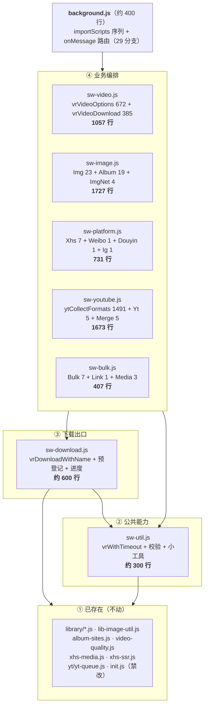

# background.js 拆分方案（基于调用关系实测）

> 日期：2026-11-18 ｜ 依据：`analyze_bg.py` 对 8436 行 / 138 个顶层函数的调用关系分析
> 目的：为「全部统一走 adapter + 拆掉巨石」提供可执行、可回退的路径

---

## 一、实测数据（不是估计）

| 指标 | 数值 |
|---|---|
| 总行数 | 8436 |
| 顶层函数 | 138 |
| `importScripts` 已加载模块 | 20+ |
| 消息路由分支 | 29 |
| 跨组调用最大密度 | `misc → Img` 仅 **5 次** |

**结论：耦合比预想的稀疏得多。** 跨组调用最多 5 次，说明可以按组切开。

---

## 二、11 个被多组依赖的"公共函数"（必须先抽底层）

| 函数 | 被几组依赖 | 依赖次数 | 归属 |
|---|---|---|---|
| **`vrWithTimeout`** | **9 组** | **11** | 工具 |
| **`vrDownloadWithName`** | **6 组** | **9** | 下载出口 |
| `vrDropDownload` | 5 组 | 7 | 下载清理 |
| `vrWaitDownload` | 5 组 | 7 | 下载等待 |
| `vrMarkDownloaded` | 5 组 | 6 | 去重账本 |
| `vrSetMediaHeadersFor` | 5 组 | 5 | DNR |
| `vrFindExistingMedia` | 4 组 | 4 | 去重查询 |
| `vrDownloadLooksInvalid` | 4 组 | 4 | 校验 |
| `vrAbortFilename` | 3 组 | 3 | 命名 |
| `vrOffscreenDownload` | 3 组 | 3 | 离屏 |
| `vrMediaIdentity` | 3 组 | 3 | 身份键 |

**这就是拆分顺序的依据**：这 11 个必须先落到一个底层模块，否则它们会跟着各自的小组散落。

---

## 三、目标结构（5 层 + 1 路由）

### 各模块职责与行数

| 模块 | 内容 | 行数 | 依赖 |
|---|---|---|---|
| **`background.js`** | `importScripts` 顺序 + `onMessage` 路由 | ~400 | 全部 |
| `sw-util.js` | `vrWithTimeout` + 校验工具 + 小函数 | ~300 | 无 |
| `sw-download.js` | `vrDownloadWithName` / 预登记 / 进度 / 清理 | ~600 | util + library |
| `sw-video.js` | 视频选项 + 视频下载 | 1057 | download + util |
| `sw-image.js` | 图片 + 图集 + 网络缓存 | 1727 | download + util |
| `sw-platform.js` | 小红书/微博/抖音/IG | 731 | download + util |
| `sw-youtube.js` | `ytCollectFormats` + YT + Merge | 1673 | download + util |
| `sw-bulk.js` | 批量 + 链接 + 媒体 | 407 | download + util |

**合计仍 ~6900 行**，但**每个文件职责单一**，`background.js` 从 8436 → ~400。

---

## 四、执行顺序（每步可回退）

### 阶段 0：先抽底层（零风险）

| 步 | 动作 | 验收 |
|---|---|---|
| 0.1 | 建 `sw-util.js`，搬 `vrWithTimeout` + 校验类 | 回归 47/47 |
| 0.2 | 建 `sw-download.js`，搬 `vrDownloadWithName` 等 9 个 | 回归 47/47 |

**为什么先做这两步**：它们被 9 组 / 6 组依赖，先落地后，后面各组搬迁时不用再互相引用。

### 阶段 1：按组搬迁（每步独立）

| 步 | 搬到 | 函数数 | 行数 | 验收 |
|---|---|---|---|---|
| 1.1 | `sw-video.js` | 2 | 1057 | 47/47 |
| 1.2 | `sw-image.js` | 46 | 1727 | 47/47 |
| 1.3 | `sw-youtube.js` | 11 | 1673 | 47/47 |
| 1.4 | `sw-platform.js` | 10 | 731 | 47/47 |
| 1.5 | `sw-bulk.js` | 11 | 407 | 47/47 |

**每步只做「剪切 + 粘贴 + 调 importScripts 顺序」，不改任何函数体。**

### 阶段 2：adapter 层（新增，零风险）

| 步 | 内容 |
|---|---|
| 2.1 | 定 adapter 接口 + 注册表 |
| 2.2 | 5 个 adapter（B站含 wbi / 抖音 / X / 小红书 / 微博） |
| 2.3 | `pager.js` 改通用执行器 |

### 阶段 3：接线（唯一改逻辑的一步）

| 步 | 内容 |
|---|---|
| 3.1 | 枚举结果 → `vrImgBatch` / `vrBulkDownload` |
| 3.2 | 端到端验证（登录态） |

---

## 五、风险与回退

| 风险 | 应对 |
|---|---|
| 搬迁漏函数 | 每步用 `analyze_bg.py` 重跑，确认函数数守恒 |
| `importScripts` 顺序错 | 每步跑 `node --check` + 回归 |
| 全局状态断裂 | 顶层 `const/var` 跟函数一起搬，不留在原处 |
| adapter 接线出错 | 阶段 2 是纯新增，阶段 3 才动调用 |

**回退方式**：每步一个 `git commit`，失败就 `git checkout` 单文件。

---

## 六、明确不做

| 项 | 理由 |
|---|---|
| 改 `relPath` 主键 | 425 处引用，风险远超收益；引用悬空已可局部修 |
| 动 `init.js` / `m3u8.js` / FFmpeg 链路 | **ADR-015 禁改区** |
| 重写函数体 | 只搬不改，保持行为等价 |
